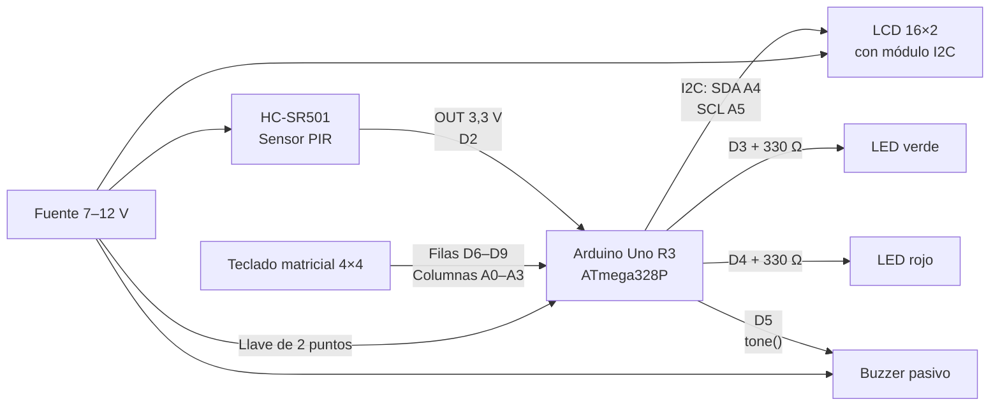
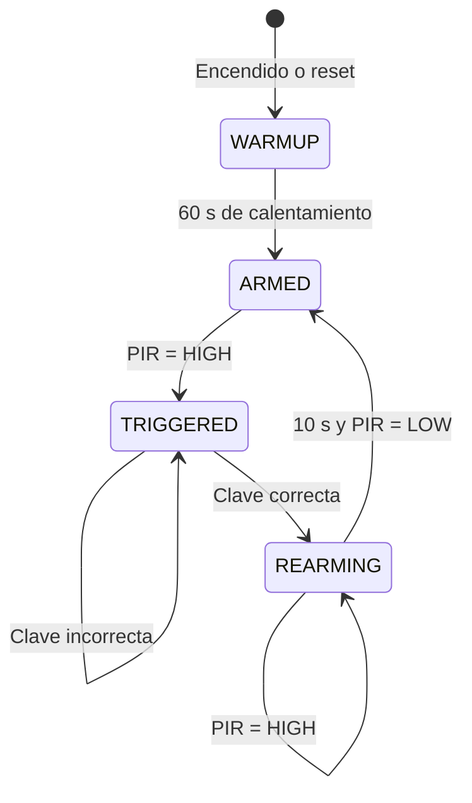
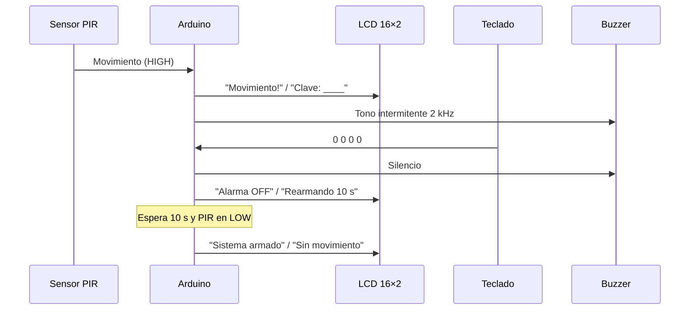

<style>
@page {
  size: A4;
  margin: 2.5cm;
  @top-right {
    content: counter(page);
    font-family: "Times New Roman", serif;
    font-size: 10pt;
    color: #333;
  }
  @bottom-left {
    content: "EEST N°1 – 5°3";
    font-family: "Times New Roman", serif;
    font-size: 8pt;
    color: #666;
  }
  @bottom-center {
    content: "9 de noviembre de 2026";
    font-family: "Times New Roman", serif;
    font-size: 8pt;
    color: #666;
  }
  @bottom-right {
    content: "Manual del Programador";
    font-family: "Times New Roman", serif;
    font-size: 8pt;
    color: #666;
  }
}
body {
  text-align: justify;
  font-family: "Times New Roman", Georgia, serif;
  font-size: 11pt;
  line-height: 1.5;
  color: #111;
}
h1, h2, h3, h4 {
  text-align: left;
}
.portada h1, .portada h2, .portada h3 {
  text-align: center;
}
code, pre {
  text-align: left;
}
table {
  font-size: 9.5pt;
}
</style>

<div class="portada" align="center">

<br><br><br>

<strong>EEST N°1</strong>

<br><br><br>

<h1>Manual del Programador</h1>

<h2>Alarma con sensor de movimiento y clave de desactivación</h2>

<h3>Proyecto Integrador – Sistemas Digitales I</h3>

<br><br><br>

<strong>Integrantes</strong><br>
Alexis Maier<br>
Aramis Demaria<br>
Santino Laudati<br>
Ian Quiroga

<br><br>

<strong>Curso:</strong> 5°3<br>
<strong>Materia:</strong> Sistemas Digitales I<br>
<strong>Profesor:</strong> Lic. Prof. Nicolás Salimbeni<br>
<strong>Fecha:</strong> 9 de noviembre de 2026

<br><br><br>

</div>

<div style="page-break-after: always;"></div>

## Resumen

Este manual documenta el diseño, la implementación y las pruebas de una alarma con sensor de movimiento y clave de desactivación, desarrollada como Proyecto Integrador de la materia Sistemas Digitales I. El sistema utiliza un Arduino Uno R3, un sensor infrarrojo pasivo HC-SR501, un teclado matricial de 4×4, una pantalla LCD de 16×2, un LED verde, un LED rojo, un buzzer pasivo y una llave de encendido general. La alarma permanece en reposo con el LED verde encendido; cuando el PIR detecta movimiento, enciende el LED rojo y activa un sonido intermitente. La única forma de volver al reposo es ingresar la clave correcta de cuatro dígitos por el teclado. El documento incluye el marco teórico de los componentes, el diseño de hardware, la máquina de estados, el código fuente completo, los cuatro problemas disparadores de la cátedra, el plan de pruebas, la operación, el mantenimiento y las referencias en formato APA 7. La clave de fábrica es `0000`; el sistema espera 60 segundos de calentamiento del PIR al encender, silencia el buzzer durante 15 segundos mientras se ingresa la clave y se rearma 10 segundos después de una desactivación correcta.

**Palabras clave:** Arduino, sensor PIR, teclado matricial, alarma, máquina de estados, sistemas digitales, LCD 16×2, buzzer.

<div style="page-break-after: always;"></div>

## Índice

1. Introducción
   1.1. Propósito y alcance
   1.2. A quién está dirigido
   1.3. Convenciones del documento
   1.4. Trazabilidad con la consigna
2. Descripción general del sistema
   2.1. Objetivo funcional
   2.2. Diagrama en bloques
   2.3. Modos de operación
   2.4. Máquina de estados
   2.5. Requerimientos funcionales
   2.6. Requerimientos no funcionales
   2.7. Decisiones de diseño
3. Marco teórico y componentes
   3.1. Arduino Uno R3
   3.2. Sensor PIR HC-SR501
   3.3. Teclado matricial 4×4
   3.4. LCD 16×2 y módulo I2C
   3.5. LEDs
   3.6. Buzzer pasivo
   3.7. DIP switch de 4 llaves
   3.8. Llave interruptor de 2 puntos
   3.9. Resistencias
   3.10. Protoboard y cables
   3.11. Registro fotográfico de los componentes
4. Diseño de hardware
   4.1. Lista de materiales
   4.2. Asignación de pines
   4.3. Conexionado paso a paso
   4.4. Teclado 4×4
   4.5. LCD 16×2 con I2C
   4.6. Variante de LCD paralelo
   4.7. Alimentación y consumo
   4.8. Buenas prácticas de montaje
5. Diseño de software
   5.1. Arquitectura
   5.2. Librerías
   5.3. Máquina de estados
   5.4. Constantes y estructuras de datos
   5.5. API de funciones
   5.6. Flujo principal
   5.7. Gestión del tiempo con `millis()`
   5.8. Manejo de la clave
   5.9. Patrón del buzzer
   5.10. Pantalla LCD
   5.11. Depuración por monitor serie
   5.12. Casos borde y errores
6. Código fuente de la alarma
   6.1. Sketch completo
   6.2. Explicación por bloques
   6.3. Compilación y carga
   6.4. Salida esperada
   6.5. Cambio de clave y de tiempos
   6.6. Variante con LCD paralelo
   6.7. Variante con buzzer activo
7. Problemas disparadores
   7.1. Problema 1: LED con dos pulsadores
   7.2. Problema 2: PIR y pulsador B
   7.3. Problema 3: teclado 4×4 al monitor serie
   7.4. Problema 4: función lógica Z = C·(A+B)
   7.5. Integración de los disparadores en la alarma
8. Pruebas y puesta en marcha
   8.1. Estrategia de pruebas
   8.2. Plan de pruebas
   8.3. Pruebas unitarias
   8.4. Pruebas de integración
   8.5. Criterios de aceptación
   8.6. Solución de problemas
   8.7. Registro de pruebas
9. Operación y mantenimiento
   9.1. Modo de uso
   9.2. Indicadores
   9.3. Mantenimiento y calibración
   9.4. Limitaciones
   9.5. Mejoras futuras
10. Conclusiones
11. Referencias
Anexo A. Tablas de verdad
Anexo B. Cálculos de resistencias
Anexo C. Mapa de pines de todos los sketches
Anexo D. Lista de verificación para la expo
Anexo E. Glosario
Anexo F. Formato, justificación y exportación a PDF

<div style="page-break-after: always;"></div>

## 1. Introducción

### 1.1. Propósito y alcance

Este documento es el **Manual del Programador** del proyecto “Alarma con sensor de movimiento y clave de desactivación”, solicitado en la consigna de la página 2 del trabajo práctico de Sistemas Digitales I (Salimbeni, 2026). Su propósito es explicar cómo está construido el sistema, cómo funciona, cómo se programa, cómo se prueba y cómo se mantiene, de modo que otra persona pueda replicarlo o modificarlo sin depender de sus autores.

El alcance incluye:

- El diseño completo de la alarma final: hardware, cableado, máquina de estados, código fuente y pruebas.
- Los cuatro problemas disparadores de la página 1 del trabajo práctico, resueltos con sketches independientes y con su correspondiente circuito.
- La lista de materiales, los cálculos de resistencias, el mapa de pines, la operación, el mantenimiento y las referencias.
- Una guía de exportación a PDF con texto justificado, fecha y numeración de páginas, según el formato solicitado.

No se incluye el diseño de una placa de circuito impreso, el encapsulado comercial ni la certificación eléctrica del producto, porque el proyecto se implementa sobre protoboard con fines didácticos.

### 1.2. A quién está dirigido

El manual está pensado para:

- Los integrantes del grupo, como documentación de referencia y respaldo del proyecto.
- El profesor de la cátedra, como parte del informe solicitado en la consigna.
- Un programador que reciba el proyecto en el futuro y necesite entender el código, cambiar la clave, ajustar los tiempos o agregar funciones.
- Un usuario técnico que deba montar, operar o reparar el dispositivo.

Se suponen conocimientos básicos de Arduino, C++, electrónica digital y uso de protoboard. Cuando se introduce un concepto nuevo, se explica brevemente en el marco teórico o en el glosario del Anexo E.

**Edad recomendada.** El proyecto está pensado para estudiantes de **13 a 16 años**, que cursan el segundo ciclo de la escuela secundaria. A esa edad ya se pueden comprender la lógica de la máquina de estados, el conexionado en protoboard y las nociones básicas de electricidad que el manual supone. Se recomienda que un docente o un adulto responsable supervise el montaje, especialmente el uso de herramientas de corte, la conexión de la alimentación y cualquier tarea de soldadura. El dispositivo no es un juguete: las piezas pequeñas (LEDs, resistencias y jumpers) representan riesgo de ingestión, y la llave de encendido debe quedar fuera del alcance de niños pequeños. Para estudiantes de 10 a 12 años puede usarse como actividad demostrativa, siempre que el adulto arme el circuito y explique cada paso; para mayores de 16 años el contenido sigue siendo válido como introducción a los sistemas embebidos.

### 1.3. Convenciones del documento

- **HIGH / LOW**: niveles lógicos de 5 V y 0 V, respectivamente.
- **Activo alto**: el componente se enciende o se activa cuando el pin está en HIGH. Los LEDs y el buzzer de este proyecto se conectan de esa manera.
- **`Dn`**: pin digital `n` del Arduino Uno. **`An`**: pin analógico `n`, utilizado aquí como entrada o salida digital cuando corresponde.
- **`PIR`**: sensor infrarrojo pasivo HC-SR501.
- **`LCD`**: pantalla de cristal líquido de 16 columnas por 2 filas.
- **`clave`**: secuencia de cuatro dígitos que desactiva la alarma. La clave de fábrica es `0000`.
- Los bloques de código se presentan completos y comentados; los fragmentos que solo ilustran un cambio se identifican como tales.
- Las tablas y figuras se numeran de forma correlativa y se citan en el texto.
- Las referencias se presentan en formato APA 7 (American Psychological Association, 2020), con sangría francesa al exportar a PDF.
- En el código y en el LCD se evitan las tildes y la letra ñ, porque el controlador HD44780 no garantiza esos caracteres. En el texto del manual se usa la ortografía completa del español.

### 1.4. Trazabilidad con la consigna

La Tabla 1 relaciona cada requisito de la consigna con la parte del manual y del sistema que lo implementa.

**Tabla 1**

*Trazabilidad entre la consigna y la solución propuesta*

| Requisito de la consigna | Implementación en el proyecto | Dónde se documenta |
|---|---|---|
| Estado de reposo indicado con un LED verde encendido | LED verde en D3, encendido en el estado `ARMED` | Secciones 4.2, 5.3 y 6 |
| Estado activo indicado con un LED rojo encendido y un buzzer con sonido intermitente | LED rojo en D4 y buzzer pasivo en D5, con patrón de 2 kHz | Secciones 4.2, 5.9 y 6 |
| Detección mediante sensor de movimiento PIR 501 | HC-SR501 alimentado a 5 V, salida en D2 | Secciones 3.2, 4.3 y 5.3 |
| Desactivación únicamente con la clave correcta por teclado matricial | Teclado 4×4 en D6–D9 y A0–A3; clave `0000` de cuatro dígitos | Secciones 3.3, 5.8 y 6 |
| Informe por grupo con toda la documentación | Este manual, más los anexos de pruebas y exportación | Todo el documento |
| Presentación audiovisual para la expo técnica | Guion, checklist y preguntas frecuentes | Anexo D |
| Problemas disparadores 1 a 4 | Cuatro sketches independientes con circuito y pruebas | Sección 7 |

*Nota.* El archivo `Componentes.txt` ya incluye el LCD 16×2, los LEDs verde y rojo, el buzzer pasivo, los dos pulsadores, el potenciómetro de 10 kΩ y la resistencia de 220 Ω. El único elemento que se agregó para la alarma es la fuente de alimentación.

*Materiales pendientes.* A la fecha de esta versión todavía no se incorporaron las 11 fotografías, el registro de pruebas de la sección 8.7 ni el archivo de la presentación audiovisual. Los lugares están señalados en el texto para completarlos antes de la entrega final.

## 2. Descripción general del sistema

### 2.1. Objetivo funcional

El sistema debe detectar la presencia de una persona mediante el sensor PIR y responder con una alarma visual y sonora. Mientras no haya detección, debe mostrar un estado de reposo con el LED verde encendido. Cuando detecte movimiento, debe encender el LED rojo y hacer sonar el buzzer de forma intermitente. La alarma debe quedar **enclavada**: aunque la persona deje de moverse, el LED rojo y el sonido continúan hasta que se ingrese la clave correcta por el teclado. Una vez ingresada la clave, el sistema vuelve al reposo y se rearma después de 10 segundos y de que el PIR vuelva a LOW.

El comportamiento se resume en cuatro estados: calentamiento (`WARMUP`), armado (`ARMED`), alarma (`TRIGGERED`) y rearme (`REARMING`). La clave de fábrica es `0000` y se define en una constante del código.

### 2.2. Diagrama en bloques

La Figura 1 muestra la arquitectura física del sistema. El Arduino Uno R3 es el controlador central; el PIR y el teclado son entradas; el LCD, los LEDs y el buzzer son salidas. La llave de dos puntos corta la alimentación externa del conjunto.

**Figura 1**

*Diagrama en bloques de la alarma*



*Nota.* El DIP switch de cuatro llaves no forma parte de la alarma final; se utiliza en el problema disparador 4 (sección 7.4). El módulo LCD puede ser I2C o paralelo; en la Figura 1 se representa la variante I2C, que es la recomendada.

### 2.3. Modos de operación

La Tabla 2 describe el comportamiento visible de cada estado.

**Tabla 2**

*Modos de operación y salidas del sistema*

| Estado | LED verde | LED rojo | Buzzer | LCD | Descripción |
|---|---|---|---|---|---|
| `WARMUP` | Parpadea cada 500 ms | Apagado | Silencio | “Calentando PIR” y cuenta regresiva | Espera de estabilización del PIR al encender |
| `ARMED` | Encendido | Apagado | Silencio | “Sistema armado” / “Sin movimiento” | Reposo; detecta movimiento |
| `TRIGGERED` | Apagado | Encendido | Intermitente (2 kHz) | “Movimiento!” / “Clave: ____” | Alarma activa; espera la clave |
| `REARMING` | Encendido | Apagado | Silencio | “Alarma OFF” / “Rearmando” | Espera de 10 s y de que el PIR vuelva a reposo |

*Nota.* Durante el ingreso de la clave, el buzzer se silencia hasta 15 segundos después de la última tecla. Si el usuario se aleja sin completar la clave, el sonido vuelve automáticamente. Si la clave es incorrecta, se muestran “Clave incorrecta” y “Intente de nuevo” durante 1,5 segundos, suenan tres beeps de error y luego se reanuda la alarma.

### 2.4. Máquina de estados

La Figura 2 presenta las transiciones permitidas. No existe una transición directa de `WARMUP` a `TRIGGERED`: el sistema siempre pasa por `ARMED`. Tampoco se puede desactivar desde `ARMED`, porque en reposo no hay alarma que desactivar; la clave solo se evalúa en `TRIGGERED`.

**Figura 2**

*Máquina de estados de la alarma*



*Nota.* La transición `TRIGGERED → TRIGGERED` por clave incorrecta incluye el aviso de error y el regreso automático al sonido de alarma. La transición `REARMING → REARMING` evita que el sistema se rearme mientras la persona siga frente al sensor.

### 2.5. Requerimientos funcionales

**Tabla 3**

*Requerimientos funcionales*

| Código | Requerimiento | Criterio de aceptación |
|---|---|---|
| RF-01 | Detectar movimiento con el PIR | El sistema pasa a `TRIGGERED` cuando la salida del PIR está en HIGH durante al menos 150 ms (la confirmación efectiva tarda entre 150 y 200 ms por el muestreo cada 50 ms) |
| RF-02 | Indicar reposo con LED verde | LED verde encendido de forma continua en `ARMED` |
| RF-03 | Indicar alarma con LED rojo | LED rojo encendido en `TRIGGERED` |
| RF-04 | Emitir sonido intermitente | Buzzer a 2 kHz con 250 ms encendido y 350 ms apagado |
| RF-05 | Desactivar solo con la clave correcta | `strcmp` entre la clave ingresada y `PASSWORD` devuelve 0 |
| RF-06 | Informar clave incorrecta | LCD con mensaje de error, tres beeps y reanudación de la alarma |
| RF-07 | Calentar el PIR al encender | Cuenta regresiva de 60 s antes de armar |
| RF-08 | Rearmar con seguridad | 10 s en `REARMING` y PIR en LOW |
| RF-09 | Mostrar el estado en el LCD | Mensajes definidos en la Tabla 15 |
| RF-10 | Permitir depuración por serie | Mensajes a 9600 baudios |
| RF-11 | Encendido y apagado general | Llave de dos puntos en serie con la alimentación externa |
| RF-12 | Silenciar el buzzer al tipear | Silencio temporal de 15 s desde la última tecla |

### 2.6. Requerimientos no funcionales

**Tabla 4**

*Requerimientos no funcionales*

| Código | Requerimiento | Justificación |
|---|---|---|
| RNF-01 | Tiempo de respuesta menor a 500 ms | La detección y la alarma deben percibirse inmediatas |
| RNF-02 | Clave de cuatro dígitos | Equilibrio entre seguridad básica y facilidad de uso |
| RNF-03 | Alimentación de 5 V y bajo consumo | Compatible con USB y con fuentes de 5 V |
| RNF-04 | Código modular y comentado | Facilita el mantenimiento y la evaluación |
| RNF-05 | Bajo costo y componentes de kit | Adecuado al presupuesto escolar |
| RNF-06 | Baja tensión, sin riesgo eléctrico | Todo el sistema funciona a 5 V o 9 V |
| RNF-07 | Montaje reproducible en protoboard | Permite reconstruirlo y trasladarlo |
| RNF-08 | Documentación completa en español | Cumple con el informe solicitado |

### 2.7. Decisiones de diseño

- **Clave fija de cuatro dígitos (`0000`)**: se almacena en una constante y se puede cambiar antes de compilar. No se guarda en EEPROM para mantener el código simple y evitar escrituras accidentales.
- **Sin bloqueo por intentos fallidos**: la consigna no lo pide y un bloqueo podría dejar al usuario sin acceso. Cada clave incorrecta se informa y se permite reintentar.
- **Calentamiento de 60 s**: el HC-SR501 necesita entre 30 y 60 segundos para estabilizarse; se muestra una cuenta regresiva para que el usuario sepa que el sistema todavía no está armado.
- **Rearme de 10 s**: después de una desactivación correcta, el sistema espera a que el PIR vuelva a LOW para evitar un disparo inmediato.
- **Silencio temporal de 15 s**: al presionar la primera tecla, el buzzer se detiene para facilitar el ingreso; si el usuario se aleja, el sonido vuelve automáticamente.
- **LCD I2C recomendado**: reduce el cableado a cuatro hilos y deja libres los pines D10–D13. Se documenta también la variante paralela por si el grupo consigue un LCD sin módulo I2C.
- **Buzzer pasivo**: permite generar una frecuencia audible definida por software. Si se consigue un buzzer activo, se explica cómo adaptar el código en la sección 6.7.
- **Llave de dos puntos como corte general**: se coloca en serie con la alimentación externa; no se corta el cable USB de la PC.

<div style="page-break-before: always;"></div>

## 3. Marco teórico y componentes

### 3.1. Arduino Uno R3

El Arduino Uno R3 es una placa de desarrollo basada en el microcontrolador ATmega328P de Microchip. Funciona a 16 MHz, tiene 32 KB de memoria Flash (de los cuales 0,5 KB los ocupa el gestor de arranque), 2 KB de SRAM y 1 KB de EEPROM. Dispone de 14 pines digitales de entrada/salida, seis de ellos con PWM (D3, D5, D6, D9, D10 y D11), y seis entradas analógicas (A0 a A5). La alimentación recomendada es de 7 a 12 V por el conector de batería, o 5 V por USB; la lógica trabaja a 5 V (Arduino, 2024).

Cada pin digital puede entregar o recibir hasta 20 mA de forma recomendada y 40 mA como máximo absoluto. Por eso los LEDs se conectan siempre con una resistencia limitadora. El bus I2C utiliza las líneas SDA (A4) y SCL (A5), y el puerto serie utiliza D0 (RX) y D1 (TX). En este proyecto D0 y D1 quedan libres para el monitor serie.

El Uno R3 se eligió por su disponibilidad, su compatibilidad con las librerías de teclado y LCD, su cantidad de pines y su protección contra sobretensiones en el puerto USB. La placa también incorpora un LED en D13; ese LED se enciende durante el arranque y puede parpadear si se usa D13 como señal, por lo que en la alarma se evitó asignar funciones críticas a ese pin.

> **[Fotografía 1 – espacio reservado].** Insertar aquí una foto cenital de la placa Arduino Uno R3, con el puerto USB hacia la izquierda y los rótulos de los pines visibles. Archivo sugerido: `fotos/01-arduino-uno.jpg`.

### 3.2. Sensor PIR HC-SR501

El HC-SR501 es un módulo de detección de movimiento infrarrojo pasivo. No emite energía: detecta cambios en la radiación infrarroja que emiten los cuerpos a través de una lente de Fresnel. Cuando una persona se mueve dentro de su campo de visión, el sensor entrega un nivel alto en su salida. Según el fabricante, acepta una alimentación de 4,5 a 20 V, consume aproximadamente 65 mA, entrega una salida TTL de 3,3 V y cubre un ángulo de hasta 120° con un alcance de 3 a 7 metros (HC-SR501, n.d.).

El módulo tiene dos potenciómetros y un jumper:

- **Sx (sensibilidad)**: ajusta el alcance de detección, aproximadamente de 3 a 7 metros.
- **Tx (tiempo de retardo)**: ajusta cuánto tiempo permanece la salida en alto después de una detección. Puede ir de unos pocos segundos a varios minutos, según el módulo.
- **Jumper H/L**: en H habilita el disparo repetido (la salida sigue en alto mientras haya movimiento); en L habilita el disparo único (la salida vuelve a bajo después del tiempo de retardo aunque la persona siga moviéndose). Para una alarma se recomienda H, porque mantiene la detección activa mientras la persona esté presente.

El sensor necesita un calentamiento de 30 a 60 segundos después de energizarse para estabilizar su lectura. Durante ese tiempo puede entregar falsos positivos. Por eso el firmware lo ignora y muestra una cuenta regresiva de 60 segundos.

Limitaciones prácticas: el PIR puede dispararse con fuentes de calor, luz solar directa, corrientes de aire, mascotas, vidrios que reflejan infrarrojo o personas que se mueven detrás de una ventana. Conviene montarlo entre 1,5 y 2 metros de altura, lejos de la salida de aire del LCD o del buzzer, y orientado hacia la zona de paso. La salida de 3,3 V es compatible con el umbral de HIGH del Arduino a 5 V en la mayoría de las unidades, pero si se observan lecturas inestables se puede interponer un buffer o un adaptador de nivel. No usar un divisor resistivo: reduciría la tensión por debajo del umbral de HIGH y empeoraría la lectura.

> **[Fotografía 2 – espacio reservado].** Insertar un primer plano del HC-SR501 de frente, donde se vean la lente de Fresnel, los dos potenciómetros (Sx y Tx) y el jumper H/L. Archivo sugerido: `fotos/02-sensor-pir.jpg`.

### 3.3. Teclado matricial 4×4

El teclado es una matriz de 16 pulsadores organizada en cuatro filas y cuatro columnas. Para leerlo no se necesitan 16 pines, sino ocho: cuatro filas y cuatro columnas. La librería `Keypad` recorre las columnas, una por vez, y lee las filas para identificar qué tecla está presionada (Stanley & Brevig, n.d.). Las teclas típicas son `1` a `9`, `0`, `*`, `#` y `A` a `D`. En este proyecto solo se usan los dígitos y el asterisco para borrar; la almohadilla no se usa porque la clave se valida automáticamente al ingresar el cuarto dígito.

El teclado de membrana tiene un conector flexible de ocho contactos. El orden puede variar entre fabricantes, por lo que siempre se debe verificar con un multímetro en modo continuidad: se identifican las cuatro filas y las cuatro columnas midiendo qué contactos se cierran al presionar cada tecla. En la sección 4.4 se propone un orden típico y un procedimiento de verificación.

La librería configura las filas como entradas con resistencia de pull-up interna y las columnas como salidas. Por eso no hacen falta resistencias externas para el teclado. El antirrebote se configura por software en 20 ms, suficiente para un teclado de membrana.

> **[Fotografía 3 – espacio reservado].** Insertar una foto del teclado 4×4 visto desde arriba, con la serigrafía completa y el conector flexible a la vista. Archivo sugerido: `fotos/03-teclado-4x4.jpg`.

### 3.4. LCD 16×2 y módulo I2C

El LCD de 16×2 está basado en el controlador HD44780, que maneja dos filas de 16 caracteres con una matriz de puntos de 5×8 (Hitachi, n.d.). Puede conectarse en modo paralelo de 8 bits, en modo paralelo de 4 bits o mediante un módulo I2C que integra un expansor PCF8574 (Texas Instruments, n.d.). En este proyecto se recomienda la variante I2C porque utiliza solo cuatro cables: VCC, GND, SDA y SCL.

El módulo I2C suele tener dirección `0x27` o `0x3F`. Si la pantalla no responde, se prueba la otra dirección o se ejecuta un escáner I2C. El módulo incluye un potenciómetro de contraste y, en muchos casos, un jumper para la luz de fondo. La librería `LiquidCrystal_I2C` de Frank de Brabander permite usar una interfaz muy similar a la del LCD paralelo (Brabander, n.d.).

El LCD muestra caracteres ASCII; no se garantizan tildes, ñ, signos de apertura ni símbolos especiales. Por eso los mensajes del firmware se escriben sin acentos: “Calentando PIR”, “Sistema armado”, “Movimiento!”, “Clave incorrecta”, “Alarma OFF”, “Rearmando”. En el manual se explican los mensajes y su significado.

> **[Fotografía 4 – espacio reservado].** Insertar una foto del LCD 16×2 de frente, encendido y mostrando un mensaje de prueba, y una segunda toma de la parte trasera con el módulo I2C y la dirección `0x27` o `0x3F` visible. Archivos sugeridos: `fotos/04-lcd-i2c-frente.jpg` y `fotos/04-lcd-i2c-dorso.jpg`.

### 3.5. LEDs

Un LED es un diodo emisor de luz. Tiene polaridad: el ánodo es la pata larga y se conecta al positivo; el cátodo es la pata corta y se conecta al negativo. Si se invierte, no enciende y puede dañarse. En este proyecto los LEDs se conectan en forma activa alta: el ánodo va al pin del Arduino a través de una resistencia de 330 Ω y el cátodo a GND.

La resistencia limita la corriente. Para un LED de 2 V de caída directa y una corriente deseada de 9 mA, con una salida de 5 V:

$$R = \frac{V_{CC} - V_F}{I} = \frac{5\,\text{V} - 2\,\text{V}}{0{,}009\,\text{A}} \approx 333\,\Omega$$

El valor comercial más cercano es 330 Ω, que deja una corriente de aproximadamente 9,1 mA, dentro del rango seguro del pin y con brillo suficiente. El cálculo completo se desarrolla en el Anexo B.

> **[Fotografía 5 – espacio reservado].** Insertar una foto de los LEDs verde y rojo apoyados sobre un fondo blanco, con la pata larga (ánodo) y la pata corta (cátodo) identificadas. Archivo sugerido: `fotos/05-leds.jpg`.

### 3.6. Buzzer pasivo

Un buzzer pasivo es un transductor piezoeléctrico que necesita una señal alterna para sonar; no tiene oscilador interno. El Arduino genera esa señal con la función `tone(pin, frecuencia)`, que produce una onda cuadrada de la frecuencia indicada (Arduino, n.d.-d). En este proyecto se usa una frecuencia de 2 kHz, dentro del rango audible y con un volumen adecuado para interiores.

El patrón de alarma es intermitente: 250 ms encendido y 350 ms apagado. La función `tone()` no bloquea el programa; el cambio de encendido a apagado se controla con `millis()` para no detener el resto del sistema. Un buzzer activo, en cambio, tiene oscilador propio y solo necesita HIGH o LOW; la sección 6.7 explica cómo adaptar el código si el grupo consigue uno de esos.

> **[Fotografía 6 – espacio reservado].** Insertar una foto del buzzer pasivo de frente y de perfil, junto a una regla o una moneda como referencia de tamaño. Archivo sugerido: `fotos/06-buzzer.jpg`.

### 3.7. DIP switch de 4 llaves

El DIP switch es un conjunto de cuatro interruptores deslizantes en una sola cápsula. Cada llave es un contacto normalmente abierto. Se usa en el problema disparador 4 para ingresar las variables lógicas A, B y C; la cuarta llave queda libre.

Para leerlo se conecta un lado de cada llave a un pin del Arduino y el otro lado a GND. El pin se configura como `INPUT_PULLUP`: cuando la llave está abierta, el pin lee HIGH; cuando está cerrada, lee LOW. Como la consigna pide que la llave cerrada represente un 1 lógico, el código invierte la lectura con `!digitalRead(pin)`. La resistencia de 1 kΩ puede colocarse en serie entre el común de las llaves y GND como protección, aunque no es imprescindible si se usan las resistencias internas.

> **[Fotografía 7 – espacio reservado].** Insertar una foto del DIP switch de cuatro llaves con el número 1 visible y las llaves en posiciones distintas. Archivo sugerido: `fotos/07-dip-switch.jpg`.

### 3.8. Llave interruptor de 2 puntos

La llave de dos puntos es un interruptor de dos posiciones (encendido/apagado). En este proyecto se usa como **corte de la alimentación externa**: se coloca en serie con la fuente que alimenta el Arduino y el protoboard. De esta manera, al apagarla se deja de energizar el conjunto alimentado por esa fuente. Importante: la llave **no corta la alimentación que llega por USB**; si el Arduino está conectado a la PC, hay que desconectar el USB o usar un cable con interruptor para apagarlo por completo.

No se recomienda cortar el cable USB de la PC, porque el USB también transporta datos y porque algunos cables no toleran interrupciones. La forma correcta es usar una fuente de **7 a 12 V** (o una batería de 9 V) con conector de barril, y poner la llave entre el positivo de la fuente y el conector del Arduino. No conviene alimentar el conector de barril con 5 V, porque queda por debajo del rango recomendado de la placa y el regulador puede no entregar una salida estable. Si se alimenta por USB, se puede usar un cable USB con interruptor o una regleta con llave, sin cortar el cable original.

> **[Fotografía 8 – espacio reservado].** Insertar una foto de la llave de dos puntos de frente y de perfil, mostrando los terminales de conexión. Archivo sugerido: `fotos/08-llave-2-puntos.jpg`.

### 3.9. Resistencias

En el proyecto se usan dos resistencias de 330 Ω y una de 1 kΩ:

- **330 Ω** (naranja, naranja, marrón): limitan la corriente de los LEDs verde y rojo.
- **1 kΩ** (marrón, negro, rojo): se usa como protección en el común del DIP switch del problema 4 y, opcionalmente, como resistencia de base si se agrega un transistor para el buzzer.

La potencia disipada por las resistencias es muy baja. Para el LED: \(P = I^2 R = (0{,}0091)^2 \times 330 \approx 0{,}027\,\text{W}\), muy por debajo de los 0,25 W de una resistencia común de 1/4 W. Para la de 1 kΩ con 5 V: \(P = V^2/R = 25/1000 = 0{,}025\,\text{W}\). No se requiere disipador.

> **[Fotografía 9 – espacio reservado].** Insertar una foto de las tres resistencias alineadas (dos de 330 Ω y una de 1 kΩ), con el código de colores visible y una etiqueta con el valor de cada una. Archivo sugerido: `fotos/09-resistencias.jpg`.

### 3.10. Protoboard y cables

La protoboard permite armar el circuito sin soldadura. Tiene dos rieles verticales (rojo para positivo y azul o negro para negativo) y filas de contactos conectadas internamente en grupos de cinco. El canal central separa las filas superiores de las inferiores. Los rieles no están conectados entre sí en todos los modelos: si se usan ambos lados, hay que unir los rieles con cables.

Buenas prácticas:

- Usar rojo para 5 V, negro para GND y amarillo o verde para señales.
- Verificar continuidad con el multímetro antes de energizar.
- No dejar puntas de cable sueltas dentro del protoboard.
- Mantener un único GND común para Arduino, PIR, LCD, LEDs y buzzer.
- No conectar nada a D0 ni D1 si se va a usar el monitor serie.
- Desconectar la alimentación antes de mover cables.

> **[Fotografía 10 – espacio reservado].** Insertar una foto del protoboard de 830 puntos y de un juego de cables macho/macho, macho/hembra y hembra/hembra ordenados por color. Archivo sugerido: `fotos/10-protoboard-cables.jpg`.

### 3.11. Registro fotográfico de los componentes

En esta versión del manual las fotografías todavía no están incorporadas. En cada subsección anterior se dejó un párrafo resaltado que indica el lugar exacto donde debe ir la imagen, qué debe mostrar y el nombre de archivo sugerido. Las fotografías se numeran como **Fotografía 1 a Fotografía 11** para no alterar la numeración de las figuras 1 a 3 que ya se citan en el texto.

**Criterios para tomar las fotos.**

- **Fondo:** usar una superficie blanca o de un solo color, sin objetos ni cables sueltos.
- **Iluminación:** luz natural o difusa; evitar el flash directo, que genera reflejos sobre el LCD, los LEDs y la cápsula del PIR.
- **Encuadre:** el componente debe ocupar al menos dos tercios del ancho de la imagen y estar centrado.
- **Escala:** incluir una regla o una moneda junto al componente para dar referencia de tamaño.
- **Detalle:** tomar una vista general y, cuando haga falta, un primer plano de conectores, serigrafía o jumpers.
- **Resolución:** al menos 1200 px de ancho, en formato JPG o PNG.
- **Autoría:** usar fotos propias del grupo; si se toma una imagen de internet, citar la fuente y verificar la licencia.

**Cómo insertar cada foto.**

1. Guardar la imagen en la carpeta `fotos/` del proyecto, con el nombre indicado en el párrafo reservado.
2. Reemplazar el párrafo reservado por el bloque de imagen.
3. Escribir el número y el epígrafe arriba de la imagen, y la nota debajo.
4. Verificar que la ruta del archivo coincida con la carpeta real.

Plantilla de inserción:

```markdown
**Fotografía 4**

*LCD 16×2 con módulo I2C*


*Nota.* La pantalla muestra el mensaje “Sistema armado”; el módulo I2C va montado en la parte posterior.
```

*Nota.* Si la cátedra exige una única serie de figuras, renumerar las fotografías como Figuras 3 a 13 y desplazar el diagrama de secuencia de la sección 5.3 a Figura 14. Si no se consigue alguna foto, eliminar el párrafo reservado y renumerar las siguientes.

<div style="page-break-before: always;"></div>

## 4. Diseño de hardware

### 4.1. Lista de materiales

La Tabla 5 contiene la lista completa. Los componentes marcados como “kit” ya figuraban en `Componentes.txt`; el único marcado como “agregar” es la fuente de alimentación.

**Tabla 5**

*Lista de materiales (BOM)*

| # | Componente | Cant. | Especificación | Uso | Origen |
|---|---|---|---|---|---|
| 1 | Arduino Uno R3 | 1 | ATmega328P, 16 MHz, 5 V | Controlador | Kit |
| 2 | Sensor PIR HC-SR501 | 1 | 4,5–20 V, salida 3,3 V | Detección de movimiento | Kit |
| 3 | Teclado matricial 4×4 | 1 | Membrana, 8 contactos | Ingreso de clave | Kit |
| 4 | LCD 16×2 con I2C | 1 | HD44780 + PCF8574 | Interfaz de usuario | Kit |
| 5 | LED verde | 1 | 5 mm, 2 V, 20 mA | Indicador de reposo | Kit |
| 6 | LED rojo | 1 | 5 mm, 2 V, 20 mA | Indicador de alarma | Kit |
| 7 | Buzzer pasivo | 1 | Piezoeléctrico, 5 V | Alarma sonora | Kit |
| 8 | Resistencia 330 Ω | 2 | 1/4 W, ±5 % | Limitación de LEDs | Kit |
| 9 | Resistencia 1 kΩ | 1 | 1/4 W, ±5 % | Protección del DIP / base | Kit |
| 10 | DIP switch de 4 llaves | 1 | Azul, 4 SPST | Problema 4 | Kit |
| 11 | Llave interruptor de 2 puntos | 1 | SPDT | Encendido general | Kit |
| 12 | Pulsadores momentáneos | 2 | Normalmente abiertos | Problemas 1 y 2 | Kit |
| 13 | Protoboard | 1 | 830 puntos | Montaje | Kit |
| 14 | Cables | 1 set | M/M, F/F, M/F | Conexiones | Kit |
| 15 | Potenciómetro 10 kΩ | 1 | Lineal | Contraste (solo LCD paralelo) | Kit |
| 16 | Resistencia 220 Ω | 1 | 1/4 W | Luz de fondo (solo LCD paralelo) | Kit |
| 17 | Fuente 7–12 V / 1 A o batería 9 V | 1 | Con conector de barril | Alimentación | Agregar |

*Nota.* Si se usa el LCD con módulo I2C, no hacen falta el potenciómetro de 10 kΩ ni la resistencia de 220 Ω, porque el módulo ya incluye el contraste y la luz de fondo. La resistencia de 1 kΩ no es obligatoria para la alarma; se usa en el problema 4 y puede servir como resistencia de base si se agrega un transistor para el buzzer. Las dos resistencias de 330 Ω se reutilizan en los problemas 1 a 4; no hace falta una por sketch.

### 4.2. Asignación de pines

La Tabla 6 es la referencia oficial del firmware de la alarma. Cualquier cambio de pin debe acompañarse del cambio de la constante correspondiente en el código.

**Tabla 6**

*Asignación de pines de la alarma*

| Componente | Pin del componente | Pin Arduino | Modo | Observaciones |
|---|---|---|---|---|
| PIR HC-SR501 | VCC | 5V | Alimentación | 5 V estables |
| PIR HC-SR501 | GND | GND | Alimentación | GND común |
| PIR HC-SR501 | OUT | D2 | `INPUT` | Salida TTL de 3,3 V |
| LED verde | Ánodo | D3 | `OUTPUT` | A través de 330 Ω; cátodo a GND |
| LED rojo | Ánodo | D4 | `OUTPUT` | A través de 330 Ω; cátodo a GND |
| Buzzer pasivo | Positivo | D5 | `OUTPUT` | `tone()` a 2 kHz; negativo a GND |
| Teclado 4×4 | R1 | D6 | Salida de escaneo | Fila 1 |
| Teclado 4×4 | R2 | D7 | Salida de escaneo | Fila 2 |
| Teclado 4×4 | R3 | D8 | Salida de escaneo | Fila 3 |
| Teclado 4×4 | R4 | D9 | Salida de escaneo | Fila 4 |
| Teclado 4×4 | C1 | A0 | `INPUT_PULLUP` | Columna 1 |
| Teclado 4×4 | C2 | A1 | `INPUT_PULLUP` | Columna 2 |
| Teclado 4×4 | C3 | A2 | `INPUT_PULLUP` | Columna 3 |
| Teclado 4×4 | C4 | A3 | `INPUT_PULLUP` | Columna 4 |
| LCD 16×2 I2C | VCC | 5V | Alimentación | 5 V |
| LCD 16×2 I2C | GND | GND | Alimentación | GND común |
| LCD 16×2 I2C | SDA | A4 | I2C | Datos |
| LCD 16×2 I2C | SCL | A5 | I2C | Reloj |
| Llave de 2 puntos | COM / NO | — | — | En serie con la fuente externa |
| DIP switch (P4) | COM | GND mediante 1 kΩ | — | Problema 4 |
| DIP switch (P4) | SW1 | D2 | `INPUT_PULLUP` | Variable A |
| DIP switch (P4) | SW2 | D3 | `INPUT_PULLUP` | Variable B |
| DIP switch (P4) | SW3 | D4 | `INPUT_PULLUP` | Variable C |
| DIP switch (P4) | SW4 | — | — | No se usa |
| Pulsador A (P1) | Terminal 1 / 2 | D2 / GND | `INPUT_PULLUP` | Problema 1 |
| Pulsador B (P1/P2) | Terminal 1 / 2 | D3 / GND | `INPUT_PULLUP` | Problemas 1 y 2 |
| LED de práctica (P1/P2) | Ánodo | D8 | `OUTPUT` | A través de 330 Ω |

*Nota.* Los pines D10 a D13 quedan libres en la alarma. Los sketches de los problemas 1, 2 y 4 usan otros pines porque se cargan por separado; no se debe montar la alarma y el problema 4 al mismo tiempo con el mismo Arduino.

### 4.3. Conexionado paso a paso

1. **Desconectar la alimentación** del Arduino y de la fuente externa antes de empezar.
2. **Armar los rieles**: llevar 5 V y GND desde el Arduino al protoboard. Unir los rieles de ambos lados si el modelo no lo hace internamente.
3. **Conectar el PIR**: VCC a 5 V, GND a GND y OUT a D2. No alimentarlo con 3,3 V.
4. **Conectar los LEDs**: ánodo del verde a D3 con la resistencia de 330 Ω en serie; cátodo a GND. Repetir con el rojo en D4. La pata larga es el ánodo.
5. **Conectar el buzzer**: positivo a D5 y negativo a GND. Si el buzzer tiene marcas de polaridad, respetarlas.
6. **Conectar el teclado**: identificar las filas y columnas (sección 4.4) y llevar R1–R4 a D6–D9 y C1–C4 a A0–A3.
7. **Conectar el LCD I2C**: VCC a 5 V, GND a GND, SDA a A4 y SCL a A5. Ajustar el contraste con el potenciómetro del módulo.
8. **Conectar la llave de dos puntos** en serie con el positivo de la fuente externa, antes del conector de barril del Arduino. No cortar el cable USB. Recordar que, si hay USB conectado, la llave no corta esa alimentación.
9. **Verificar continuidad** entre 5 V y GND con el multímetro; debe haber alta resistencia, no cortocircuito.
10. **Energizar** y observar el LCD. Si no hay texto, revisar el contraste, la dirección I2C y el cableado antes de cargar el programa.

> **[Fotografía 11 – espacio reservado].** Insertar una foto del montaje completo sobre el protoboard, con todos los módulos conectados y los cables ordenados por color. Archivo sugerido: `fotos/11-montaje-final.jpg`.

### 4.4. Teclado 4×4

El conector de membrana suele tener ocho contactos en este orden: R1, R2, R3, R4, C1, C2, C3, C4. Sin embargo, el orden cambia entre fabricantes. Para verificarlo:

1. Poner el multímetro en continuidad o en la escala de diodos.
2. Identificar los cuatro contactos que se cierran entre sí al presionar una tecla de la misma fila.
3. Identificar los cuatro contactos que se cierran al presionar una tecla de la misma columna.
4. Anotar la matriz y compararla con la Tabla 7. Si el teclado está rotado, se corrige el orden de los pines o el mapa de teclas en el código.

**Tabla 7**

*Correspondencia típica del teclado 4×4*

| Fila / columna | C1 (A0) | C2 (A1) | C3 (A2) | C4 (A3) |
|---|---|---|---|---|
| R1 (D6) | 1 | 2 | 3 | A |
| R2 (D7) | 4 | 5 | 6 | B |
| R3 (D8) | 7 | 8 | 9 | C |
| R4 (D9) | * | 0 | # | D |

*Nota.* El mapa de teclas del código debe coincidir con esta tabla. Si al presionar “1” aparece “4”, probablemente las filas estén invertidas; si aparece “2”, las columnas están corridas.

### 4.5. LCD 16×2 con I2C

**Tabla 8**

*Conexionado del LCD con módulo I2C*

| Pin del módulo | Pin Arduino | Función |
|---|---|---|
| VCC | 5V | Alimentación |
| GND | GND | Referencia común |
| SDA | A4 | Datos I2C |
| SCL | A5 | Reloj I2C |

La dirección I2C más común es `0x27`; algunos módulos usan `0x3F`. Si el LCD muestra dos filas de bloques o queda en blanco, probar la otra dirección. El potenciómetro del módulo ajusta el contraste: girarlo lentamente hasta que el texto se lea con claridad. Si el módulo tiene un jumper de luz de fondo, dejarlo colocado.

Para verificar la dirección se puede cargar un escáner I2C mínimo:

```cpp
#include <Wire.h>

void setup() {
  Wire.begin();
  Serial.begin(9600);
  Serial.println(F("Escaneando I2C..."));
  for (uint8_t addr = 1; addr < 127; addr++) {
    Wire.beginTransmission(addr);
    if (Wire.endTransmission() == 0) {
      Serial.print(F("Dispositivo en 0x"));
      Serial.println(addr, HEX);
    }
  }
}

void loop() { }
```

*Nota.* Este sketch es solo de diagnóstico; no forma parte de la alarma.

### 4.6. Variante de LCD paralelo

Si el grupo consigue un LCD 16×2 sin módulo I2C, se puede usar en modo paralelo de 4 bits. La Tabla 9 propone una asignación que no entra en conflicto con el teclado. En esta variante se ocupan A4 y A5 para los datos del LCD, por lo que no queda disponible el bus I2C.

**Tabla 9**

*Conexionado del LCD paralelo de 4 bits*

| Pin del LCD | Pin Arduino | Función |
|---|---|---|
| VSS (1) | GND | GND |
| VDD (2) | 5V | Alimentación |
| V0 (3) | Wiper del potenciómetro 10 kΩ | Contraste |
| RS (4) | D10 | Selección de registro |
| RW (5) | GND | Solo escritura |
| E (6) | D11 | Habilitación |
| D4 (11) | D12 | Dato 4 |
| D5 (12) | D13 | Dato 5 |
| D6 (13) | A4 | Dato 6 |
| D7 (14) | A5 | Dato 7 |
| A (15) | 5V mediante 220 Ω o 330 Ω | Ánodo de luz de fondo |
| K (16) | GND | Cátodo de luz de fondo |

El potenciómetro de 10 kΩ se conecta entre 5 V y GND; el terminal central va a V0. Si no se consigue, se puede probar V0 a GND para máximo contraste, aunque el resultado no siempre es óptimo. El LED de fondo se conecta con una resistencia de 220 Ω o 330 Ω; sin ella puede consumir demasiado y dañarse.

Cambios en el código:

```cpp
// Reemplazar las dos líneas de I2C:
// #include <Wire.h>
// #include <LiquidCrystal_I2C.h>
// LiquidCrystal_I2C lcd(0x27, 16, 2);

#include <LiquidCrystal.h>
LiquidCrystal lcd(10, 11, 12, 13, A4, A5);
```

En `setup()` se reemplaza `lcd.init();` por `lcd.begin(16, 2);` y se elimina `lcd.backlight();`, porque la luz de fondo queda conectada permanentemente. El LED onboard de D13 puede parpadear durante las escrituras al LCD; es normal en esta variante.

### 4.7. Alimentación y consumo

**Tabla 10**

*Consumo estimado de la alarma*

| Componente | Corriente típica | Observaciones |
|---|---:|---|
| Arduino Uno R3 | 50 mA | Sin periféricos |
| PIR HC-SR501 | 65 mA | Calentamiento y funcionamiento |
| LCD 16×2 con I2C | 20 mA | Con luz de fondo |
| LED verde | 9 mA | Con 330 Ω |
| LED rojo | 9 mA | Con 330 Ω |
| Buzzer pasivo | 30 mA | A 5 V, intermitente; conviene un transistor |
| Teclado | < 1 mA | Escaneo |
| **Total estimado** | **≈ 183 mA** | Dentro de los 500 mA del USB |

El Arduino Uno puede alimentar los periféricos desde su pin 5 V, pero la corriente total disponible depende de la fuente. Con USB de una PC se dispone de hasta 500 mA; con una fuente de 7–12 V/1 A conectada al conector de barril hay margen suficiente. Una batería de 9 V tiene poca capacidad (típicamente 500 mAh) y el regulador de la placa disipa energía, por lo que la autonomía puede ser de pocas horas. Para una demostración corta alcanza; para un uso prolongado conviene una fuente de 7–12 V/1 A o un pack de seis pilas AA.

El PIR entrega 3,3 V en su salida. El Arduino Uno interpreta como HIGH cualquier tensión superior a aproximadamente 3,0 V, por lo que en general funciona directo. Si el sensor está lejos o hay ruido, se puede agregar un buffer o un adaptador de nivel. No usar un divisor resistivo: bajaría la tensión por debajo del umbral de HIGH (~3,0 V) y la lectura se volvería más inestable. No alimentar el PIR con 3,3 V: el módulo necesita al menos 4,5 V.

El pin digital entrega 20 mA de forma recomendada y 40 mA como máximo absoluto. El buzzer de este proyecto consume unos 30 mA, por encima del valor recomendado aunque dentro del máximo: para un montaje definitivo conviene manejarlo con un transistor NPN (por ejemplo, 2N2222) con una resistencia de 1 kΩ en la base, el buzzer entre 5 V y el colector, y un diodo de rueda libre si el buzzer es magnético. El código no cambia: sigue usando `tone()` en el pin de control.

### 4.8. Buenas prácticas de montaje

- Montar el PIR lejos del buzzer, del LCD y de las fuentes de calor; orientarlo hacia la zona de paso.
- No ubicar el PIR frente a una ventana con sol directo ni frente a una salida de aire.
- Mantener los cables de señal cortos y separados de los de alimentación.
- Etiquetar los cables del teclado y del LCD para facilitar el mantenimiento.
- Usar una caja con aberturas para el LCD, el teclado, el PIR, los LEDs y el buzzer.
- Dejar accesible el potenciómetro de contraste del LCD.
- Fijar el Arduino y el protoboard para que no se muevan durante la exposición.
- Revisar que no haya hilos de cable tocando otro contacto antes de energizar.
- Colocar la llave de encendido en un lugar visible y seguro.
- Documentar cualquier cambio de pin en la Tabla 6 y en el código.

<div style="page-break-before: always;"></div>

## 5. Diseño de software

### 5.1. Arquitectura

El firmware se implementa en un único archivo `.ino`, pero se organiza internamente en capas para que sea fácil de leer y mantener:

- **Configuración**: constantes de pines, tiempos, clave y tamaños. Es la única parte que se modifica para cambiar el comportamiento básico.
- **Drivers de entrada**: lectura del PIR y del teclado.
- **Drivers de salida**: control de LEDs, buzzer y LCD.
- **Aplicación**: máquina de estados, validación de la clave y temporización.
- **Interfaz**: mensajes del LCD y trazas del monitor serie.

El programa no usa `delay()` dentro del `loop()`: todas las esperas se resuelven con `millis()`. Así el teclado y el PIR siguen respondiendo mientras el buzzer suena, mientras se muestra una cuenta regresiva o mientras se espera el rearme. Tampoco se usa memoria dinámica (`new`, `malloc` ni objetos `String` en el camino crítico), para evitar la fragmentación de la SRAM del ATmega328P.

### 5.2. Librerías

**Tabla 11**

*Librerías utilizadas*

| Librería | Autor / origen | Uso | Instalación |
|---|---|---|---|
| `Wire` | Arduino | Comunicación I2C con el LCD | Incluida en el IDE |
| `LiquidCrystal_I2C` | Frank de Brabander | Control del LCD con módulo I2C | Gestor de librerías: “LiquidCrystal I2C” |
| `Keypad` | Mark Stanley y Alexander Brevig | Lectura del teclado 4×4 | Gestor de librerías: “Keypad” |

En el Arduino IDE 2.x se abre **Sketch → Include Library → Manage Libraries**, se busca el nombre y se instala la versión estable más reciente. La librería `Wire` ya viene con el IDE y no se instala por separado (Arduino, n.d.-a).

### 5.3. Máquina de estados

La lógica principal se implementa con una enumeración `State` y una variable global `state`. Cada vez que se entra a un estado se registra el instante de entrada en `stateSince`, se actualizan las salidas y se marca el LCD para refrescar. La Tabla 12 describe las transiciones y la Figura 3 muestra la secuencia típica de una desactivación.

**Tabla 12**

*Transiciones de estado*

| Estado actual | Evento | Condición | Estado siguiente | Acciones |
|---|---|---|---|---|
| `WARMUP` | Fin del calentamiento | `millis() - stateSince >= 60000` | `ARMED` | LED verde fijo, LCD “Sistema armado” |
| `ARMED` | Movimiento | `pirActive == true` | `TRIGGERED` | LED rojo, buzzer intermitente, LCD “Movimiento!” |
| `TRIGGERED` | Tecla de dígito | `inputLen < 4` | `TRIGGERED` | Agregar dígito, mostrar máscara, silenciar buzzer |
| `TRIGGERED` | Cuarta tecla | `inputLen == 4` | `TRIGGERED` o `REARMING` | Comparar con la clave |
| `TRIGGERED` | Clave correcta | `strcmp(...) == 0` | `REARMING` | Detener buzzer, LED verde, LCD “Alarma OFF” |
| `TRIGGERED` | Clave incorrecta | `strcmp(...) != 0` | `TRIGGERED` | Error de 1,5 s, tres beeps, reanudar alarma |
| `REARMING` | Fin del rearme | `elapsed >= 10000 && !pirActive` | `ARMED` | LED verde fijo, LCD “Sistema armado” |
| `REARMING` | Movimiento persistente | `pirActive == true` | `REARMING` | Mantener LED verde y “Espere PIR...” |

**Figura 3**

*Secuencia de una desactivación correcta*



### 5.4. Constantes y estructuras de datos

**Tabla 13**

*Constantes principales del firmware*

| Constante | Valor | Unidad | Función |
|---|---:|---|---|
| `PIR_PIN` | 2 | pin | Entrada del PIR |
| `LED_GREEN` | 3 | pin | LED de reposo |
| `LED_RED` | 4 | pin | LED de alarma |
| `BUZZER_PIN` | 5 | pin | Buzzer pasivo |
| `ROWS`, `COLS` | 4, 4 | — | Tamaño del teclado |
| `PASSWORD` | `"0000"` | — | Clave de fábrica |
| `PASSWORD_LEN` | 4 | caracteres | Longitud de la clave |
| `WARMUP_MS` | 60000 | ms | Calentamiento del PIR |
| `REARM_MS` | 10000 | ms | Espera de rearme |
| `PIR_SAMPLE_MS` | 50 | ms | Período de muestreo del PIR |
| `PIR_STABLE_SAMPLES` | 3 | muestras | Antirrebote del PIR |
| `BUZZER_FREQ` | 2000 | Hz | Frecuencia del tono |
| `BUZZER_ON_MS` | 250 | ms | Tono encendido |
| `BUZZER_OFF_MS` | 350 | ms | Tono apagado |
| `ERROR_MS` | 1500 | ms | Duración del aviso de error |
| `MUTE_TIMEOUT_MS` | 15000 | ms | Silencio máximo al tipear |
| `LCD_REFRESH_MS` | 250 | ms | Período mínimo de refresco del LCD |

Las estructuras de datos principales son:

- `State state`: estado actual de la máquina.
- `unsigned long stateSince`: instante de entrada al estado actual.
- `char input[PASSWORD_LEN + 1]`: buffer de la clave ingresada.
- `uint8_t inputLen`: cantidad de dígitos ingresados.
- `bool pirActive`: lectura estable del PIR.
- `bool alarmSoundEnabled`, `bool buzzerOn`, `unsigned long buzzerPhase`: control no bloqueante del buzzer.
- `bool buzzerMuted`, `unsigned long muteStart`: silencio temporal al tipear.
- `bool errorActive`, `unsigned long errorSince`, `bool errorBuzzerOn`: aviso de clave incorrecta.
- `bool lcdDirty`, `unsigned long lastLcdRefresh`, `int lastCountdown`: control de refresco del LCD.

### 5.5. API de funciones

**Tabla 14**

*Funciones del firmware*

| Función | Firma | Propósito |
|---|---|---|
| `setup` | `void setup()` | Inicializa serie, pines, LCD, teclado y estado inicial |
| `loop` | `void loop()` | Ejecuta el ciclo principal no bloqueante |
| `enterState` | `void enterState(State newState)` | Cambia de estado y actualiza salidas |
| `updatePIR` | `void updatePIR()` | Muestrea y debouncea el PIR |
| `handleKey` | `void handleKey(char key)` | Procesa una tecla del teclado |
| `checkPassword` | `void checkPassword()` | Compara la clave ingresada con `PASSWORD` |
| `triggerError` | `void triggerError()` | Inicia el aviso de clave incorrecta |
| `updateError` | `void updateError()` | Finaliza el aviso y reanuda la alarma |
| `updateStateMachine` | `void updateStateMachine()` | Evalúa transiciones de estado |
| `updateLeds` | `void updateLeds()` | Controla LED verde y rojo |
| `updateBuzzer` | `void updateBuzzer()` | Genera el patrón intermitente y los beeps de error |
| `updateLCD` | `void updateLCD()` | Refresca los mensajes del LCD |
| `startAlarmSound` | `void startAlarmSound()` | Enciende el patrón de alarma |
| `stopAlarmSound` | `void stopAlarmSound()` | Detiene el buzzer |
| `clearInput` | `void clearInput()` | Borra el buffer de la clave |
| `buildMask` | `void buildMask(char *out)` | Construye la máscara `****` / `____` |
| `lcdPrintLine` | `void lcdPrintLine(uint8_t row, const char *text)` | Escribe una línea completa de 16 caracteres |

### 5.6. Flujo principal

El `loop()` sigue este orden:

```text
inicio
  actualizar lectura del PIR (cada 50 ms, con debounce)
  leer teclado (getKey)
  si hay tecla: procesarla
  evaluar transiciones de estado
  actualizar aviso de error
  actualizar LEDs
  actualizar buzzer
  actualizar LCD (solo si cambió algo o pasó el refresco mínimo)
fin
```

El orden es importante: primero se actualizan las entradas, luego la lógica y por último las salidas. Así, una detección del PIR o una tecla se reflejan en el mismo ciclo o en el siguiente, sin esperas.

### 5.7. Gestión del tiempo con `millis()`

`millis()` devuelve la cantidad de milisegundos desde el encendido y se desborda aproximadamente cada 49,7 días (Arduino, n.d.-b). Para comparar tiempos se usa siempre una resta entre `unsigned long`:

```cpp
unsigned long ahora = millis();
if (ahora - stateSince >= WARMUP_MS) {
  // pasaron 60 segundos
}
```

La resta funciona correctamente aunque `millis()` se desborde, siempre que ambos valores sean `unsigned long`. No se debe comparar `millis() > stateSince + WARMUP_MS` porque esa expresión falla en el desbordamiento. Tampoco se usa `delay()`: una espera bloqueante impediría leer el teclado y el PIR.

### 5.8. Manejo de la clave

La clave se almacena en `const char PASSWORD[] = "0000";`. El buffer `input` tiene cinco bytes: cuatro dígitos y el terminador nulo. El ingreso funciona así:

- Solo se aceptan los caracteres `0` a `9`.
- El asterisco `*` borra todo el buffer.
- La almohadilla `#` se ignora: al ingresar el cuarto dígito la comparación es automática y no hace falta confirmar.
- La comparación se hace con `strcmp(input, PASSWORD) == 0`.
- Si la clave es correcta, se pasa a `REARMING`.
- Si es incorrecta, se muestra el error, se borra el buffer y se reanuda la alarma.

En el LCD se muestra una máscara: `*` para cada dígito ingresado y `_` para los que faltan. Por ejemplo, después de dos dígitos se ve `Clave: **__`. Esto evita mostrar la clave en pantalla. El monitor serie sí imprime la tecla presionada para facilitar la depuración; en una versión de producción conviene ocultarla.

La clave no se guarda en EEPROM ni se cifra. Es una medida de disuasión para un proyecto escolar, no un sistema de seguridad criptográfico. Cualquier persona con acceso al código fuente puede leerla. Para cambiarla, se modifica la constante y se vuelve a compilar (sección 6.5).

### 5.9. Patrón del buzzer

El buzzer pasivo se controla con `tone(BUZZER_PIN, 2000)` y `noTone(BUZZER_PIN)` (Arduino, n.d.-d). El patrón de alarma tiene dos fases:

- **Encendido**: 250 ms con tono de 2 kHz.
- **Apagado**: 350 ms en silencio.

El cambio se controla con `buzzerPhase` y `millis()`. Cuando el usuario presiona la primera tecla válida, se llama a `stopAlarmSound()` y se guarda `muteStart = millis()`. Cada tecla nueva reinicia el plazo. Si pasan 15 segundos sin actividad y la alarma sigue activa, `updateBuzzer()` vuelve a encender el sonido automáticamente. Si la clave es incorrecta, se detiene el patrón y se generan tres beeps de error de 150 ms a 1,2 kHz durante 1,5 segundos.

Si el buzzer es activo, no se puede cambiar la frecuencia con `tone()`: se reemplaza por `digitalWrite(BUZZER_PIN, HIGH/LOW)` y se mantiene el mismo patrón de tiempos. La sección 6.7 muestra el cambio.

### 5.10. Pantalla LCD

**Tabla 15**

*Mensajes del LCD por estado*

| Estado | Línea 1 | Línea 2 | Cuándo se muestra |
|---|---|---|---|
| `WARMUP` | `Calentando PIR` | `Espere: 60 s` | Al encender; la cuenta baja cada segundo |
| `ARMED` | `Sistema armado` | `Sin movimiento` | Después del calentamiento |
| `TRIGGERED` | `Movimiento!` | `Clave: ____` | Al detectar movimiento |
| `TRIGGERED` (ingreso) | `Movimiento!` | `Clave: **__` | Después de cada tecla |
| `TRIGGERED` (error) | `Clave incorrecta` | `Intente de nuevo` | Durante 1,5 s |
| `REARMING` | `Alarma OFF` | `Rearmando 10 s` | Después de la clave correcta |
| `REARMING` (PIR alto) | `Alarma OFF` | `Espere PIR...` | Si el PIR sigue detectando movimiento |

La función `lcdPrintLine()` rellena cada línea con espacios hasta completar 16 caracteres. Así se borran los restos del mensaje anterior sin necesidad de limpiar toda la pantalla, lo que evita parpadeos. El LCD se refresca solo cuando cambia el estado, cuando se presiona una tecla, cuando empieza o termina un error, o cuando cambia el segundo de la cuenta regresiva. No se escribe en el LCD en cada vuelta del `loop()`.

### 5.11. Depuración por monitor serie

El puerto serie se configura a 9600 baudios, 8 bits, sin paridad y 1 bit de parada (8N1). El monitor serie del IDE debe usar la misma velocidad; de lo contrario se ven caracteres extraños (Arduino, n.d.-c).

**Tabla 16**

*Mensajes del monitor serie*

| Momento | Mensaje | Utilidad |
|---|---|---|
| Inicio | `=== Alarma PIR + teclado ===` | Confirma el arranque |
| Inicio | `Clave de fabrica: 0000` | Recuerda la clave |
| Inicio | `Calentando el PIR 60 s...` | Indica el estado inicial |
| Cambio de estado | `Estado: CALENTAMIENTO`, `ARMADO`, `ALARMA`, `REARMANDO` | Traza de la máquina de estados |
| Cambio de PIR | `PIR: MOVIMIENTO` o `PIR: REPOSO` | Verifica el sensor |
| Tecla | `Tecla: 0` | Verifica el teclado |
| Clave | `Clave correcta` o `Clave incorrecta` | Verifica la comparación |
| Silencio | `Buzzer silenciado (15 s)` | Confirma el modo de ingreso |
| Error | `Error de clave: 3 beeps` | Confirma el aviso |
| Fin de error | `Fin del aviso de error` | Confirma la reanudación |

*Nota.* Al abrir el monitor serie, el IDE activa la línea DTR y reinicia el Arduino. Por eso la cuenta de 60 segundos vuelve a empezar cada vez que se abre el monitor. Para probar sin esperar, se puede reducir `WARMUP_MS` a 5000 durante el desarrollo y volver a 60000 antes de la entrega.

### 5.12. Casos borde y errores

- **El PIR queda en HIGH al terminar el calentamiento**: el sistema pasa a `ARMED` y, en el siguiente ciclo, a `TRIGGERED`. Es el comportamiento esperado si hay una persona frente al sensor.
- **El PIR queda trabado en HIGH**: la alarma no se rearma hasta que vuelva a LOW. El LCD muestra “Espere PIR...”. Si el problema persiste, revisar la alimentación, el jumper y los potenciómetros.
- **Se mantiene una tecla presionada**: la librería `Keypad` entrega la tecla una sola vez por pulsación; no se repite el dígito. El antirrebote es de 20 ms.
- **Se ingresa una clave incorrecta**: se muestran “Clave incorrecta” e “Intente de nuevo”, suenan tres beeps y la alarma vuelve a sonar. No hay bloqueo por intentos.
- **Se corta la alimentación**: al volver, el sistema arranca en `WARMUP` y pierde la clave ingresada; la clave de fábrica sigue siendo `0000`.
- **El LCD no responde**: la alarma sigue funcionando; solo se pierde la interfaz visual. Revisar dirección I2C, contraste y cableado.
- **El teclado no responde**: revisar el orden de filas y columnas, la continuidad del conector y la alimentación del Arduino.
- **El buzzer no suena**: verificar si es pasivo o activo, la polaridad, el pin D5 y la conexión a GND.
- **El Arduino se reinicia cuando suena el buzzer**: el consumo del buzzer puede superar la corriente disponible; usar una fuente más potente o un transistor.
- **El monitor serie muestra basura**: cambiar la velocidad a 9600 baudios.

<div style="page-break-before: always;"></div>

## 6. Código fuente de la alarma

### 6.1. Sketch completo

El siguiente sketch se copia en un archivo `Alarma_PIR_Teclado.ino` del Arduino IDE. Está comentado por bloques para facilitar su estudio y su modificación.

```cpp
/*
  ============================================================
  Alarma con sensor de movimiento y clave de desactivación
  Proyecto Integrador - Sistemas Digitales I
  Arduino Uno R3 + PIR HC-SR501 + teclado 4x4 + LCD 16x2 I2C
  ============================================================

  Comportamiento:
  - WARMUP: calentamiento del PIR (60 s), LED verde parpadeando.
  - ARMED: reposo, LED verde encendido.
  - TRIGGERED: movimiento, LED rojo y buzzer intermitente.
  - REARMING: clave correcta, LED verde y espera de 10 s.

  Clave de fábrica: 0000
  ============================================================
*/

#include <Wire.h>
#include <LiquidCrystal_I2C.h>
#include <Keypad.h>
#include <string.h>
#include <stdio.h>

// -------------------- Pines --------------------
const uint8_t PIR_PIN = 2;
const uint8_t LED_GREEN = 3;
const uint8_t LED_RED = 4;
const uint8_t BUZZER_PIN = 5;

// -------------------- Teclado 4x4 --------------------
const byte ROWS = 4;
const byte COLS = 4;
char keys[ROWS][COLS] = {
  {'1', '2', '3', 'A'},
  {'4', '5', '6', 'B'},
  {'7', '8', '9', 'C'},
  {'*', '0', '#', 'D'}
};
byte rowPins[ROWS] = {6, 7, 8, 9};
byte colPins[COLS] = {A0, A1, A2, A3};
Keypad keypad = Keypad(makeKeymap(keys), rowPins, colPins, ROWS, COLS);

// -------------------- LCD 16x2 I2C --------------------
// Si el módulo usa 0x3F, cambiar la dirección.
LiquidCrystal_I2C lcd(0x27, 16, 2);

// -------------------- Clave --------------------
const char PASSWORD[] = "0000";
const uint8_t PASSWORD_LEN = 4;

// -------------------- Tiempos --------------------
const unsigned long WARMUP_MS = 60000UL;
const unsigned long REARM_MS = 10000UL;
const unsigned long PIR_SAMPLE_MS = 50UL;
const uint8_t PIR_STABLE_SAMPLES = 3;
const unsigned long BUZZER_ON_MS = 250UL;
const unsigned long BUZZER_OFF_MS = 350UL;
const unsigned int BUZZER_FREQ = 2000;
const unsigned long ERROR_MS = 1500UL;
const unsigned long MUTE_TIMEOUT_MS = 15000UL;
const unsigned long LCD_REFRESH_MS = 250UL;

// -------------------- Estados --------------------
enum State { WARMUP, ARMED, TRIGGERED, REARMING };
State state = WARMUP;
unsigned long stateSince = 0;

// -------------------- Variables --------------------
char input[PASSWORD_LEN + 1];
uint8_t inputLen = 0;

bool pirActive = false;
bool lastPirRaw = LOW;
bool stablePir = LOW;
uint8_t pirCount = 0;
unsigned long lastPirSample = 0;

bool alarmSoundEnabled = false;
bool buzzerOn = false;
unsigned long buzzerPhase = 0;
bool buzzerMuted = false;
unsigned long muteStart = 0;

bool errorActive = false;
unsigned long errorSince = 0;
bool errorBuzzerOn = false;

bool lcdDirty = true;
unsigned long lastLcdRefresh = 0;
int lastCountdown = -1;

// -------------------- Prototipos --------------------
void enterState(State newState);
void updatePIR();
void handleKey(char key);
void checkPassword();
void triggerError();
void updateError();
void updateStateMachine();
void updateLeds();
void updateBuzzer();
void updateLCD();
void startAlarmSound();
void stopAlarmSound();
void clearInput();
void buildMask(char *out);
void lcdPrintLine(uint8_t row, const char *text);

// ============================================================
// setup
// ============================================================
void setup() {
  Serial.begin(9600);

  pinMode(PIR_PIN, INPUT);
  pinMode(LED_GREEN, OUTPUT);
  pinMode(LED_RED, OUTPUT);
  pinMode(BUZZER_PIN, OUTPUT);

  digitalWrite(LED_GREEN, LOW);
  digitalWrite(LED_RED, LOW);
  noTone(BUZZER_PIN);

  lcd.init();
  lcd.backlight();
  lcd.clear();

  keypad.setDebounceTime(20);

  Serial.println(F("=== Alarma PIR + teclado ==="));
  Serial.println(F("Clave de fabrica: 0000"));
  Serial.println(F("Calentando el PIR 60 s..."));

  enterState(WARMUP);
}

// ============================================================
// loop principal
// ============================================================
void loop() {
  updatePIR();

  char key = keypad.getKey();
  if (key) handleKey(key);

  updateStateMachine();
  updateError();
  updateLeds();
  updateBuzzer();
  updateLCD();
}

// ============================================================
// Cambio de estado
// ============================================================
void enterState(State newState) {
  state = newState;
  stateSince = millis();
  lastCountdown = -1;
  lcdDirty = true;
  clearInput();

  switch (newState) {
    case WARMUP:
      stopAlarmSound();
      buzzerMuted = false;
      errorActive = false;
      Serial.println(F("Estado: CALENTAMIENTO"));
      break;

    case ARMED:
      stopAlarmSound();
      buzzerMuted = false;
      errorActive = false;
      Serial.println(F("Estado: ARMADO"));
      break;

    case TRIGGERED:
      buzzerMuted = false;
      errorActive = false;
      startAlarmSound();
      Serial.println(F("Estado: ALARMA"));
      break;

    case REARMING:
      stopAlarmSound();
      buzzerMuted = false;
      errorActive = false;
      Serial.println(F("Estado: REARMANDO"));
      break;
  }
}

// ============================================================
// Lectura del PIR con antirrebote
// ============================================================
void updatePIR() {
  unsigned long now = millis();
  if (now - lastPirSample < PIR_SAMPLE_MS) return;
  lastPirSample = now;

  bool raw = digitalRead(PIR_PIN);

  if (raw != lastPirRaw) {
    lastPirRaw = raw;
    pirCount = 0;
  } else if (pirCount < PIR_STABLE_SAMPLES) {
    pirCount++;
    if (pirCount >= PIR_STABLE_SAMPLES) {
      stablePir = raw;
      if (stablePir != pirActive) {
        pirActive = stablePir;
        if (pirActive) Serial.println(F("PIR: MOVIMIENTO"));
        else Serial.println(F("PIR: REPOSO"));
      }
    }
  }
}

// ============================================================
// Teclado y clave
// ============================================================
void handleKey(char key) {
  if (state != TRIGGERED || errorActive) return;

  bool isDigit = (key >= '0' && key <= '9');
  bool isControl = (key == '*' || key == '#');
  if (!isDigit && !isControl) return;

  unsigned long now = millis();

  if (!buzzerMuted) {
    buzzerMuted = true;
    stopAlarmSound();
    Serial.println(F("Buzzer silenciado (15 s)"));
  }
  muteStart = now;

  Serial.print(F("Tecla: "));
  Serial.println(key);

  if (key == '*') {
    clearInput();
    return;
  }

  if (key == '#') {
    if (inputLen == PASSWORD_LEN) checkPassword();
    return;
  }

  if (inputLen < PASSWORD_LEN) {
    input[inputLen++] = key;
    input[inputLen] = '\0';
    lcdDirty = true;
    if (inputLen == PASSWORD_LEN) checkPassword();
  }
}

void checkPassword() {
  if (strcmp(input, PASSWORD) == 0) {
    Serial.println(F("Clave correcta"));
    clearInput();
    enterState(REARMING);
  } else {
    Serial.println(F("Clave incorrecta"));
    clearInput();
    triggerError();
  }
}

void triggerError() {
  stopAlarmSound();
  errorActive = true;
  errorSince = millis();
  errorBuzzerOn = false;
  buzzerMuted = true;
  muteStart = millis();
  lcdDirty = true;
  Serial.println(F("Error de clave: 3 beeps"));
}

void updateError() {
  if (!errorActive) return;
  if (millis() - errorSince < ERROR_MS) return;

  errorActive = false;
  noTone(BUZZER_PIN);
  errorBuzzerOn = false;
  buzzerMuted = false;
  lcdDirty = true;
  Serial.println(F("Fin del aviso de error"));

  if (state == TRIGGERED) startAlarmSound();
}

// ============================================================
// Máquina de estados
// ============================================================
void updateStateMachine() {
  unsigned long elapsed = millis() - stateSince;

  switch (state) {
    case WARMUP:
      if (elapsed >= WARMUP_MS) {
        Serial.println(F("PIR estabilizado"));
        enterState(ARMED);
      }
      break;

    case ARMED:
      if (pirActive) enterState(TRIGGERED);
      break;

    case TRIGGERED:
      break;

    case REARMING:
      if (elapsed >= REARM_MS && !pirActive) enterState(ARMED);
      break;
  }
}

// ============================================================
// Salidas: LEDs, buzzer y LCD
// ============================================================
void updateLeds() {
  bool green = false;
  bool red = false;

  switch (state) {
    case WARMUP:
      green = ((millis() - stateSince) / 500UL) % 2UL == 0UL;
      break;
    case ARMED:
      green = true;
      break;
    case TRIGGERED:
      red = true;
      break;
    case REARMING:
      green = true;
      break;
  }

  if (errorActive) {
    green = false;
    red = ((millis() - errorSince) % 300UL) < 150UL;
  }

  digitalWrite(LED_GREEN, green ? HIGH : LOW);
  digitalWrite(LED_RED, red ? HIGH : LOW);
}

void startAlarmSound() {
  alarmSoundEnabled = true;
  buzzerOn = true;
  tone(BUZZER_PIN, BUZZER_FREQ);
  buzzerPhase = millis();
}

void stopAlarmSound() {
  alarmSoundEnabled = false;
  if (buzzerOn) {
    noTone(BUZZER_PIN);
    buzzerOn = false;
  }
}

void updateBuzzer() {
  unsigned long now = millis();

  if (errorActive) {
    bool on = ((now - errorSince) % 500UL) < 150UL;
    if (on && !errorBuzzerOn) {
      tone(BUZZER_PIN, 1200);
      errorBuzzerOn = true;
    } else if (!on && errorBuzzerOn) {
      noTone(BUZZER_PIN);
      errorBuzzerOn = false;
    }
    return;
  }

  if (state == TRIGGERED && buzzerMuted && !alarmSoundEnabled &&
      (now - muteStart >= MUTE_TIMEOUT_MS)) {
    buzzerMuted = false;
    startAlarmSound();
  }

  if (!alarmSoundEnabled) return;

  if (buzzerOn) {
    if (now - buzzerPhase >= BUZZER_ON_MS) {
      noTone(BUZZER_PIN);
      buzzerOn = false;
      buzzerPhase = now;
    }
  } else {
    if (now - buzzerPhase >= BUZZER_OFF_MS) {
      tone(BUZZER_PIN, BUZZER_FREQ);
      buzzerOn = true;
      buzzerPhase = now;
    }
  }
}

void clearInput() {
  inputLen = 0;
  input[0] = '\0';
  lcdDirty = true;
}

void buildMask(char *out) {
  for (uint8_t i = 0; i < PASSWORD_LEN; i++) {
    out[i] = (i < inputLen) ? '*' : '_';
  }
  out[PASSWORD_LEN] = '\0';
}

void lcdPrintLine(uint8_t row, const char *text) {
  char buf[17];
  snprintf(buf, sizeof(buf), "%-16s", text);
  lcd.setCursor(0, row);
  lcd.print(buf);
}

void updateLCD() {
  unsigned long now = millis();

  if (!lcdDirty && (now - lastLcdRefresh < LCD_REFRESH_MS)) return;
  lastLcdRefresh = now;

  char line1[17];
  char line2[17];

  switch (state) {
    case WARMUP: {
      unsigned long elapsed = now - stateSince;
      int remaining = (elapsed < WARMUP_MS)
          ? (int)((WARMUP_MS - elapsed + 999UL) / 1000UL) : 0;
      if (!lcdDirty && remaining == lastCountdown) return;
      lastCountdown = remaining;
      strcpy(line1, "Calentando PIR");
      snprintf(line2, sizeof(line2), "Espere: %d s", remaining);
      break;
    }

    case ARMED:
      if (!lcdDirty) return;
      strcpy(line1, "Sistema armado");
      strcpy(line2, "Sin movimiento");
      break;

    case TRIGGERED:
      if (!lcdDirty) return;
      if (errorActive) {
        strcpy(line1, "Clave incorrecta");
        strcpy(line2, "Intente de nuevo");
      } else {
        char mask[PASSWORD_LEN + 1];
        buildMask(mask);
        strcpy(line1, "Movimiento!");
        snprintf(line2, sizeof(line2), "Clave: %s", mask);
      }
      break;

    case REARMING: {
      unsigned long elapsed = now - stateSince;
      int remaining = (elapsed < REARM_MS)
          ? (int)((REARM_MS - elapsed + 999UL) / 1000UL) : 0;
      if (!lcdDirty && remaining == lastCountdown) return;
      lastCountdown = remaining;
      strcpy(line1, "Alarma OFF");
      if (remaining > 0) {
        snprintf(line2, sizeof(line2), "Rearmando %d s", remaining);
      } else {
        strcpy(line2, "Espere PIR...");
      }
      break;
    }
  }

  lcdPrintLine(0, line1);
  lcdPrintLine(1, line2);
  lcdDirty = false;
}
```

*Nota.* El sketch usa `muteStart` para medir el silencio temporal con `millis()`, de modo que la comparación sea segura ante el desbordamiento del contador. La clave se compara con `strcmp` y el buffer se limpia después de cada intento.

### 6.2. Explicación por bloques

- **Includes y configuración**: se incluyen `Wire`, `LiquidCrystal_I2C`, `Keypad`, `string.h` y `stdio.h`. Las constantes de pines y tiempos están al principio para que el ajuste sea sencillo.
- **Teclado**: `keys` define el mapa de caracteres; `rowPins` y `colPins` indican las filas y columnas. `makeKeymap(keys)` convierte la matriz en el mapa que usa la librería.
- **LCD**: el objeto `lcd` se crea con la dirección `0x27`, 16 columnas y 2 filas. Si el módulo usa `0x3F`, se cambia ese valor.
- **Clave**: `PASSWORD` guarda la clave y `input` guarda lo que se va escribiendo. `PASSWORD_LEN` debe coincidir con la cantidad de caracteres de la clave.
- **Estados**: la enumeración `State` define los cuatro estados y `stateSince` guarda el instante de entrada para las cuentas regresivas.
- **`setup()`**: configura la serie a 9600, los pines, el LCD y el teclado; luego entra en `WARMUP`.
- **`loop()`**: actualiza el PIR, lee el teclado, evalúa la máquina de estados y actualiza el error, los LEDs, el buzzer y el LCD. Ninguna de estas funciones usa `delay()`.
- **`updatePIR()`**: muestrea cada 50 ms y exige tres muestras consecutivas iguales para cambiar de estado. Así se filtran los picos de ruido.
- **`handleKey()`**: solo actúa en `TRIGGERED`. Al presionar la primera tecla válida, silencia el buzzer y reinicia el plazo de 15 s. El asterisco borra; los dígitos se acumulan; al cuarto dígito se compara.
- **`checkPassword()`**: usa `strcmp`. Si coincide, pasa a `REARMING`; si no, llama a `triggerError()`.
- **`triggerError()` y `updateError()`**: muestran el mensaje de error, generan tres beeps y, al cabo de 1,5 s, reanudan la alarma.
- **`updateStateMachine()`**: aplica las transiciones de la Tabla 12. En `REARMING` exige que el PIR esté en LOW para evitar un disparo inmediato.
- **`updateLeds()`**: el verde parpadea en `WARMUP`, queda fijo en `ARMED` y `REARMING`, y se apaga en `TRIGGERED`. El rojo se enciende en `TRIGGERED` y parpadea durante el error.
- **`updateBuzzer()`**: genera el patrón de 250/350 ms y los beeps de error. Si el silencio temporal vence, vuelve a encender la alarma.
- **`updateLCD()`**: escribe solo cuando cambia el estado, se presiona una tecla, empieza o termina un error, o cambia el segundo de la cuenta. Las líneas se rellenan con espacios para borrar restos.
- **`lcdPrintLine()`**: usa `snprintf` con `%-16s` para completar la línea. Así no hace falta `lcd.clear()` en cada actualización.

El uso de memoria es moderado: el sketch ocupa pocos kilobytes de Flash y menos de 1 KB de SRAM, por lo que deja margen para agregar funciones. Las cadenas del LCD y del monitor serie son literales; si se agregan muchos textos, conviene usar `F()` o almacenarlos en Flash.

### 6.3. Compilación y carga

1. Instalar el Arduino IDE 2.x desde el sitio oficial (Arduino, n.d.-a).
2. Conectar el Arduino Uno por USB. El IDE debe reconocerlo en **Herramientas → Placa → Arduino AVR Boards → Arduino Uno**.
3. Seleccionar el puerto en **Herramientas → Puerto**. En Windows suele ser `COM3`, `COM4` o similar.
4. Instalar las librerías `Keypad` y `LiquidCrystal I2C` desde el gestor de librerías.
5. Crear un sketch nuevo, pegar el código de la sección 6.1 y guardarlo como `Alarma_PIR_Teclado.ino`.
6. Presionar **Verificar** (el botón de tilde) para compilar. Si aparece un error de librería faltante, revisar el paso 4.
7. Presionar **Subir** (la flecha) para cargar el programa.
8. Abrir el monitor serie a 9600 baudios para ver las trazas.

Errores frecuentes:

- **`LiquidCrystal_I2C.h: No such file or directory`**: falta instalar la librería o se instaló otra variante. Instalar “LiquidCrystal I2C” de Frank de Brabander.
- **`Keypad.h: No such file or directory`**: falta instalar la librería `Keypad`.
- **`avrdude: ser_open(): can't open device`**: el puerto está ocupado por otro programa o el cable USB es solo de carga. Cerrar el monitor serie, cambiar el cable o reinstalar el driver.
- **La carga falla y el Arduino tiene otro modelo**: verificar que la placa seleccionada sea Arduino Uno.
- **El LCD no muestra nada**: revisar la dirección `0x27`/`0x3F`, el contraste y las conexiones SDA/SCL. El programa puede estar funcionando aunque el LCD esté mal conectado.

### 6.4. Salida esperada

Una secuencia típica del monitor serie es la siguiente:

```text
=== Alarma PIR + teclado ===
Clave de fabrica: 0000
Calentando el PIR 60 s...
Estado: CALENTAMIENTO
PIR estabilizado
Estado: ARMADO
PIR: MOVIMIENTO
Estado: ALARMA
Buzzer silenciado (15 s)
Tecla: 0
Tecla: 0
Tecla: 0
Tecla: 0
Clave correcta
Estado: REARMANDO
PIR: REPOSO
Estado: ARMADO
```

Si se ingresa una clave incorrecta, se ve:

```text
Tecla: 1
Tecla: 2
Tecla: 3
Tecla: 4
Clave incorrecta
Error de clave: 3 beeps
Fin del aviso de error
```

### 6.5. Cambio de clave y de tiempos

Para cambiar la clave se modifica una sola línea y se vuelve a compilar:

```cpp
const char PASSWORD[] = "1234";
```

La clave debe tener exactamente cuatro caracteres. Si se cambia por una de otra longitud, también hay que ajustar `PASSWORD_LEN` y el tamaño del buffer. Para la entrega se recomienda mantener cuatro dígitos.

Para acortar el calentamiento durante las pruebas:

```cpp
const unsigned long WARMUP_MS = 5000UL;   // 5 s para prueba
```

Antes de la demostración final se vuelve a `60000UL`. Lo mismo se puede hacer con `REARM_MS`, `MUTE_TIMEOUT_MS` y `ERROR_MS`, pero conviene registrar los valores finales en la Tabla 13.

### 6.6. Variante con LCD paralelo

Además del cableado de la sección 4.6, hay que cambiar las tres líneas de la parte superior del sketch:

```cpp
#include <LiquidCrystal.h>
LiquidCrystal lcd(10, 11, 12, 13, A4, A5);
```

En `setup()` se reemplaza:

```cpp
lcd.init();
lcd.backlight();
lcd.clear();
```

por:

```cpp
lcd.begin(16, 2);
lcd.clear();
```

El resto del código no cambia. El LED onboard de D13 puede parpadear durante las escrituras; es normal.

### 6.7. Variante con buzzer activo

Si el buzzer tiene oscilador interno (buzzer activo), no se usa `tone()`. Se reemplazan las funciones de sonido por `digitalWrite()`:

```cpp
void startAlarmSound() {
  alarmSoundEnabled = true;
  buzzerOn = true;
  digitalWrite(BUZZER_PIN, HIGH);
  buzzerPhase = millis();
}

void stopAlarmSound() {
  alarmSoundEnabled = false;
  if (buzzerOn) {
    digitalWrite(BUZZER_PIN, LOW);
    buzzerOn = false;
  }
}
```

En `updateBuzzer()` se cambia `tone(BUZZER_PIN, BUZZER_FREQ)` por `digitalWrite(BUZZER_PIN, HIGH)` y `noTone(BUZZER_PIN)` por `digitalWrite(BUZZER_PIN, LOW)`. Para los beeps de error se hace lo mismo con el pin. El patrón de tiempos no cambia. Si el buzzer activo consume más de 20 mA (el valor recomendado por pin), usar un transistor y una resistencia de 1 kΩ en la base.

<div style="page-break-before: always;"></div>

## 7. Problemas disparadores

Los cuatro problemas de la página 1 del trabajo práctico se resuelven con sketches independientes. Cada uno se carga por separado y tiene su propio circuito; no se montan todos al mismo tiempo. Al final de la sección se explica cómo se integran en la alarma final.

### 7.1. Problema 1: LED con dos pulsadores

**Consigna.** Diseñar un dispositivo que permita encender un LED con un pulsador A y apagar dicho LED con otro pulsador B.

**Objetivo.** Implementar un biestable o latch de encendido/apagado: el pulsador A establece el estado encendido y el pulsador B lo restablece. El LED debe conservar el estado aunque se suelten los pulsadores.

**Tabla 17**

*Materiales y conexiones del problema 1*

| Componente | Cant. | Conexión |
|---|---:|---|
| Arduino Uno R3 | 1 | Alimentación por USB |
| Pulsador A | 1 | Entre D2 y GND; `INPUT_PULLUP` |
| Pulsador B | 1 | Entre D3 y GND; `INPUT_PULLUP` |
| LED | 1 | Ánodo a D8 mediante 330 Ω; cátodo a GND |
| Resistencia 330 Ω | 1 | Limitación del LED |
| Protoboard y cables | — | Montaje |

**Funcionamiento.** Los pulsadores se conectan a GND y se configuran con `INPUT_PULLUP`. En reposo, el pin lee HIGH; al presionar, lee LOW. El código detecta el flanco de bajada (paso de HIGH a LOW) para que una pulsación cuente una sola vez. El LED se conecta en forma activa alta: HIGH lo enciende. Si se presionan A y B al mismo tiempo, B tiene prioridad porque se evalúa después.

**Código completo.**

```cpp
const uint8_t LED_PIN = 8;
const uint8_t BTN_A = 2;
const uint8_t BTN_B = 3;

bool ledState = false;
bool lastA = HIGH;
bool lastB = HIGH;

void setup() {
  pinMode(LED_PIN, OUTPUT);
  pinMode(BTN_A, INPUT_PULLUP);
  pinMode(BTN_B, INPUT_PULLUP);
  digitalWrite(LED_PIN, LOW);

  Serial.begin(9600);
  Serial.println(F("P1: A enciende, B apaga"));
}

void loop() {
  bool a = digitalRead(BTN_A);
  bool b = digitalRead(BTN_B);

  // Flanco de bajada de A: encender.
  if (lastA == HIGH && a == LOW) {
    ledState = true;
    Serial.println(F("A: LED ON"));
  }

  // Flanco de bajada de B: apagar.
  if (lastB == HIGH && b == LOW) {
    ledState = false;
    Serial.println(F("B: LED OFF"));
  }

  lastA = a;
  lastB = b;

  digitalWrite(LED_PIN, ledState ? HIGH : LOW);
  delay(20);   // Antirrebote simple para este ejercicio
}
```

**Pruebas.**

- Al energizar, el LED debe estar apagado.
- Presionar A: el LED se enciende y queda encendido al soltar.
- Presionar B: el LED se apaga y queda apagado al soltar.
- Presionar A y B a la vez: el LED queda apagado.
- Mantener A presionado: el LED no parpadea ni se apaga.
- El monitor serie muestra `A: LED ON` y `B: LED OFF` en cada pulsación.

**Resultado esperado.** El circuito cumple la función de un latch set-reset con dos pulsadores. Es la base conceptual de la alarma: el PIR ocupa el lugar de A y el pulsador B (o la clave) ocupa el lugar del reset.

### 7.2. Problema 2: PIR y pulsador B

**Consigna.** Modificar el dispositivo anterior cambiando el pulsador A por el sensor de movimiento PIR501. El LED debe encenderse cuando el PIR detecte movimiento y apagarse al presionar el pulsador B.

**Objetivo.** Comprobar el funcionamiento del PIR como entrada de disparo y del pulsador B como reset manual. El LED debe quedar enclavado: una vez que el PIR detecta movimiento, el LED sigue encendido aunque la persona deje de moverse, hasta que se presione B.

**Tabla 18**

*Materiales y conexiones del problema 2*

| Componente | Cant. | Conexión |
|---|---:|---|
| Arduino Uno R3 | 1 | Alimentación por USB |
| Sensor PIR HC-SR501 | 1 | VCC a 5 V, GND a GND, OUT a D2 |
| Pulsador B | 1 | Entre D3 y GND; `INPUT_PULLUP` |
| LED | 1 | Ánodo a D8 mediante 330 Ω; cátodo a GND |
| Resistencia 330 Ω | 1 | Limitación del LED |
| Protoboard y cables | — | Montaje |

**Funcionamiento.** El PIR se alimenta a 5 V y su salida va a D2. El código espera 60 segundos de calentamiento antes de aceptar detecciones. Cuando la salida está en HIGH, enciende el LED y lo deja enclavado. Al presionar B, apaga el LED y activa una bandera `blockPIR` que impide que el PIR lo vuelva a encender mientras su salida siga en HIGH. Cuando el PIR vuelve a LOW, la bandera se libera y el sistema queda listo para una nueva detección. Sin esta bandera, al presionar B el LED se apagaría y volvería a encenderse en el mismo instante si la persona todavía estuviera en movimiento.

**Código completo.**

```cpp
const uint8_t PIR_PIN = 2;
const uint8_t BTN_B = 3;
const uint8_t LED_PIN = 8;
const unsigned long WARMUP_MS = 60000UL;

bool ledState = false;
bool lastB = HIGH;
bool blockPIR = false;
unsigned long startTime;

void setup() {
  pinMode(PIR_PIN, INPUT);
  pinMode(BTN_B, INPUT_PULLUP);
  pinMode(LED_PIN, OUTPUT);
  digitalWrite(LED_PIN, LOW);

  Serial.begin(9600);
  startTime = millis();
  Serial.println(F("P2: calentando PIR 60 s..."));
}

void loop() {
  bool pir = digitalRead(PIR_PIN);
  bool b = digitalRead(BTN_B);

  // Encender por movimiento, salvo que B haya bloqueado el PIR.
  if (millis() - startTime >= WARMUP_MS && pir == HIGH && !blockPIR) {
    ledState = true;
  }

  // B apaga y bloquea hasta que el PIR vuelva a reposo.
  if (lastB == HIGH && b == LOW) {
    ledState = false;
    blockPIR = true;
    Serial.println(F("B: LED OFF"));
  }
  lastB = b;

  if (pir == LOW) {
    blockPIR = false;
  }

  digitalWrite(LED_PIN, ledState ? HIGH : LOW);
  delay(20);
}
```

**Pruebas.**

- Al energizar, esperar 60 segundos sin moverse frente al PIR.
- Acercar la mano al PIR: el LED se enciende y queda encendido.
- Dejar de moverse: el LED sigue encendido.
- Presionar B: el LED se apaga aunque el PIR siga detectando movimiento.
- Esperar a que el PIR vuelva a reposo y mover la mano: el LED vuelve a encenderse.
- El monitor serie muestra `B: LED OFF` al presionar el pulsador.

**Resultado esperado.** El PIR reemplaza al pulsador A y el pulsador B funciona como reset. La diferencia con el problema 1 es que el PIR puede quedar en HIGH durante varios segundos, por eso se agrega la bandera de bloqueo. En la alarma final, la función de B se reemplaza por la clave correcta y la bandera se reemplaza por el estado `REARMING`.

<div style="page-break-before: always;"></div>

### 7.3. Problema 3: teclado 4×4 al monitor serie

**Consigna.** Realizar un programa que permita visualizar en el monitor serie de Arduino los números y caracteres de un teclado matricial de 4×4.

**Objetivo.** Verificar la lectura de las 16 teclas y mostrar en el monitor serie el carácter presionado y su código ASCII decimal.

**Tabla 19**

*Materiales y conexiones del problema 3*

| Componente | Cant. | Conexión |
|---|---:|---|
| Arduino Uno R3 | 1 | Alimentación por USB |
| Teclado matricial 4×4 | 1 | R1–R4 a D6–D9; C1–C4 a A0–A3 |
| Protoboard y cables | — | Montaje |
| Monitor serie | — | 9600 baudios |

**Funcionamiento.** La librería `Keypad` recorre las columnas y lee las filas para identificar la tecla. El mapa `keys` traduce la posición física al carácter. Cuando `getKey()` devuelve un carácter distinto de cero, el programa lo imprime junto con su valor ASCII. Si el teclado está conectado con las filas y columnas invertidas, los caracteres no coinciden con la tecla presionada; en ese caso se corrige el cableado o el mapa.

**Código completo.**

```cpp
#include <Keypad.h>

const byte ROWS = 4;
const byte COLS = 4;

char keys[ROWS][COLS] = {
  {'1', '2', '3', 'A'},
  {'4', '5', '6', 'B'},
  {'7', '8', '9', 'C'},
  {'*', '0', '#', 'D'}
};

byte rowPins[ROWS] = {6, 7, 8, 9};
byte colPins[COLS] = {A0, A1, A2, A3};

Keypad keypad = Keypad(makeKeymap(keys), rowPins, colPins, ROWS, COLS);

void setup() {
  Serial.begin(9600);
  Serial.println(F("Teclado 4x4 listo"));
}

void loop() {
  char key = keypad.getKey();

  if (key) {
    Serial.print(F("Tecla: "));
    Serial.print(key);
    Serial.print(F(" | ASCII: "));
    Serial.println((byte)key);
  }
}
```

**Pruebas.**

- Presionar cada tecla y verificar que el carácter mostrado coincida con la serigrafía.
- Comprobar los valores ASCII: `0` = 48, `1` = 49, `9` = 57, `*` = 42, `#` = 35, `A` = 65, `B` = 66, `C` = 67, `D` = 68.
- Mantener una tecla presionada: debe aparecer una sola vez por pulsación.
- Presionar dos teclas a la vez: el comportamiento puede variar; no es necesario para el proyecto.
- Verificar que no se impriman caracteres basura al soltar la tecla.

**Resultado esperado.** Cada pulsación produce una línea como `Tecla: 5 | ASCII: 53`. La tabla completa de códigos ASCII se incluye en el Anexo A.

### 7.4. Problema 4: función lógica Z = C·(A+B)

**Consigna.** Diseñar un programa que permita visualizar, con un indicador LED, el estado lógico de la función \(Z = C \cdot (A + B)\) para cada una de las combinaciones de entrada. Armar en el protoboard la etapa de conmutación de las entradas, la etapa de detección de salida con el LED y realizar las conexiones.

**Objetivo.** Implementar la función lógica con un DIP switch de cuatro llaves (se usan tres) y un LED que muestre el resultado. Verificar las ocho combinaciones posibles.

**Tabla 20**

*Materiales y conexiones del problema 4*

| Componente | Cant. | Conexión |
|---|---:|---|
| Arduino Uno R3 | 1 | Alimentación por USB |
| DIP switch de 4 llaves | 1 | Común a GND mediante 1 kΩ; SW1 a D2, SW2 a D3, SW3 a D4 |
| Resistencia 1 kΩ | 1 | Protección del común del DIP |
| LED | 1 | Ánodo a D5 mediante 330 Ω; cátodo a GND |
| Resistencia 330 Ω | 1 | Limitación del LED |
| Protoboard y cables | — | Montaje |

**Función lógica.**

$$Z = C \cdot (A + B)$$

La salida vale 1 solamente cuando C vale 1 y, además, A o B valen 1. La Tabla 21 muestra las ocho combinaciones.

**Tabla 21**

*Tabla de verdad de \(Z = C \cdot (A + B)\)*

| A | B | C | A + B | Z = C·(A+B) |
|---|---|---|---|---|
| 0 | 0 | 0 | 0 | 0 |
| 0 | 0 | 1 | 0 | 0 |
| 0 | 1 | 0 | 1 | 0 |
| 0 | 1 | 1 | 1 | 1 |
| 1 | 0 | 0 | 1 | 0 |
| 1 | 0 | 1 | 1 | 1 |
| 1 | 1 | 0 | 1 | 0 |
| 1 | 1 | 1 | 1 | 1 |

**Funcionamiento.** Las llaves del DIP se conectan entre los pines D2, D3 y D4 y el común, que va a GND a través de la resistencia de 1 kΩ. Los pines se configuran con `INPUT_PULLUP`: con la llave abierta leen HIGH, con la llave cerrada leen LOW. Como se quiere que “llave cerrada” sea 1 lógico, el código invierte la lectura con `!digitalRead(pin)`. La cuarta llave no se usa. El LED se conecta a D5 con una resistencia de 330 Ω.

**Código completo.**

```cpp
const uint8_t A_PIN = 2;
const uint8_t B_PIN = 3;
const uint8_t C_PIN = 4;
const uint8_t LED_PIN = 5;

void setup() {
  pinMode(A_PIN, INPUT_PULLUP);
  pinMode(B_PIN, INPUT_PULLUP);
  pinMode(C_PIN, INPUT_PULLUP);
  pinMode(LED_PIN, OUTPUT);

  Serial.begin(9600);
  Serial.println(F("A B C | Z"));
}

void loop() {
  bool A = !digitalRead(A_PIN);   // Llave cerrada = 1
  bool B = !digitalRead(B_PIN);
  bool C = !digitalRead(C_PIN);

  bool Z = C && (A || B);

  digitalWrite(LED_PIN, Z ? HIGH : LOW);

  Serial.print(A);
  Serial.print(' ');
  Serial.print(B);
  Serial.print(' ');
  Serial.print(C);
  Serial.print(F(" | "));
  Serial.println(Z);

  delay(250);
}
```

**Pruebas.**

- Probar las ocho combinaciones de la Tabla 21 y comparar el LED con la columna Z.
- Verificar que el LED solo se encienda en las combinaciones 011, 101 y 111 (A, B, C).
- Comprobar que la llave 4 no afecta el resultado.
- Medir con el multímetro la tensión en D5: aproximadamente 5 V cuando Z = 1 y 0 V cuando Z = 0.
- Revisar que el monitor serie muestre las ocho filas sin valores inestables.

**Resultado esperado.** El LED reproduce la función lógica para todas las combinaciones. El ejercicio introduce la etapa de conmutación con pull-ups, la lectura de variables booleanas y la escritura de una salida digital, conceptos que se reutilizan en la alarma.

### 7.5. Integración de los disparadores en la alarma

**Tabla 22**

*Aporte de cada problema disparador a la alarma final*

| Problema | Concepto principal | Cómo se usa en la alarma |
|---|---|---|
| 1 | Latch set-reset con dos pulsadores | El PIR “setea” la alarma y la clave la “resetea” |
| 2 | PIR como entrada y reset manual | El PIR dispara `TRIGGERED`; la clave reemplaza a B |
| 3 | Lectura del teclado 4×4 | Ingreso de la clave de cuatro dígitos |
| 4 | Función lógica y conmutación | Lectura de entradas digitales y salida LED; base del DIP switch |

La alarma final combina el latch del problema 1, la detección del problema 2 y el teclado del problema 3. El problema 4 no forma parte del circuito de la alarma, pero aporta la práctica de conmutación, pull-ups y salida digital que se usa en los LEDs y en el DIP switch.

<div style="page-break-before: always;"></div>

## 8. Pruebas y puesta en marcha

### 8.1. Estrategia de pruebas

Las pruebas se organizan en tres niveles:

- **Unitarias**: verifican cada subsistema por separado (PIR, teclado, LEDs, buzzer, LCD, clave).
- **De integración**: verifican la secuencia completa de armado, detección, clave correcta, clave incorrecta y rearme.
- **De aceptación**: comparan el comportamiento final con cada requisito de la consigna.

Se usan el monitor serie, el multímetro, un cronómetro y una persona que se mueve frente al PIR. Las pruebas se registran en la Tabla 25.

### 8.2. Plan de pruebas

**Tabla 23**

*Plan de pruebas del proyecto*

| ID | Objetivo | Procedimiento | Resultado esperado |
|---|---|---|---|
| T-01 | Inspección visual | Revisar conexiones, polaridad y ausencia de cortocircuitos | Sin cables sueltos ni contactos entre 5 V y GND |
| T-02 | Alimentación | Medir 5 V entre los rieles y encender el Arduino | 5 V estables y LED de encendido de la placa |
| T-03 | Calentamiento | Encender y cronometrar 60 s | LED verde parpadeando y cuenta regresiva en el LCD |
| T-04 | Detección PIR | Mover la mano frente al sensor después del calentamiento | Monitor serie: `PIR: MOVIMIENTO`; estado `ALARMA` |
| T-05 | LED verde | Observar el estado `ARMED` | LED verde encendido y fijo |
| T-06 | LED rojo | Provocar una detección | LED rojo encendido y verde apagado |
| T-07 | Buzzer | Escuchar la alarma | Tono intermitente de 250 ms on / 350 ms off |
| T-08 | Teclado | Presionar las 16 teclas | Cada tecla se reconoce con su carácter correcto |
| T-09 | Clave correcta | Ingresar `0000` en `TRIGGERED` | LED verde, buzzer detenido, LCD “Alarma OFF” |
| T-10 | Clave incorrecta | Ingresar `1111` en `TRIGGERED` | “Clave incorrecta”, tres beeps y reanudación de la alarma |
| T-11 | Silencio al tipear | Presionar una tecla y esperar 15 s sin completar | El buzzer se detiene y vuelve a sonar a los 15 s |
| T-12 | Rearme | Desactivar y esperar 10 s con el PIR en reposo | Estado `ARMED` y LED verde fijo |
| T-13 | LCD | Recorrer todos los estados | Mensajes de la Tabla 15 sin caracteres extraños |
| T-14 | Monitor serie | Abrir el monitor a 9600 | Mensajes legibles, sin basura |
| T-15 | Llave general | Apagar y encender la llave | Se apaga el conjunto alimentado por la fuente externa y vuelve a `WARMUP` |
| T-16 | Problema 1 | Cargar el sketch P1 | A enciende, B apaga, el estado se mantiene |
| T-17 | Problema 2 | Cargar el sketch P2 | PIR enciende, B apaga y bloquea hasta reposo |
| T-18 | Problema 3 | Cargar el sketch P3 | Cada tecla muestra su carácter y ASCII |
| T-19 | Problema 4 | Cargar el sketch P4 | LED y monitor serie coinciden con la Tabla 21 |

### 8.3. Pruebas unitarias

- **PIR**: alimentar el módulo, esperar 60 s y verificar con el monitor serie que `PIR: MOVIMIENTO` aparece al mover la mano y `PIR: REPOSO` al alejarse. Medir la salida con el multímetro: debe pasar de 0 V a 3,3 V.
- **Teclado**: cargar el sketch P3 y presionar las 16 teclas. Verificar el carácter y el código ASCII. Si una fila completa falla, revisar el pin de esa fila; si falla una columna, revisar el pin de esa columna.
- **LED verde**: forzar el estado `ARMED` (o esperar el calentamiento) y medir 5 V en D3. Si el LED no enciende, revisar la polaridad y la resistencia.
- **LED rojo**: provocar una detección y medir 5 V en D4. Si no enciende, revisar el cableado.
- **Buzzer**: en `TRIGGERED`, medir con el multímetro en D5; debe oscilar. Si el buzzer es pasivo, debe escucharse el tono de 2 kHz; si es activo, revisar la sección 6.7.
- **LCD**: cargar un sketch mínimo que escriba “Hola” y ajustar el contraste. Verificar la dirección I2C con el escáner de la sección 4.5.
- **Clave**: probar `0000` (correcta), `1111` (incorrecta), `*` (borrar), `#` (confirmar) y una tecla `A` (ignorada).
- **Tiempo**: cronometrar los 60 s de `WARMUP`, los 15 s de silencio y los 10 s de `REARMING`.

### 8.4. Pruebas de integración

1. **Secuencia normal**: encender, esperar 60 s, provocar movimiento, verificar LED rojo y buzzer, ingresar `0000`, verificar LED verde y rearme a los 10 s.
2. **Clave incorrecta**: provocar movimiento, ingresar `1111`, verificar el mensaje de error y que la alarma vuelva a sonar.
3. **Silencio vencido**: provocar movimiento, presionar `0`, esperar 15 s sin completar y verificar que el buzzer vuelve a sonar.
4. **PIR persistente**: desactivar con `0000` mientras una persona sigue moviéndose; verificar que el LCD muestra “Espere PIR...” y que no se rearma hasta que el PIR vuelve a reposo.
5. **Corte de energía**: apagar con la llave y volver a encender; verificar que el sistema arranca en `WARMUP` y que la clave sigue siendo `0000`.
6. **Teclado desconectado**: verificar que la alarma sigue detectando y sonando, aunque no se pueda desactivar; reconectar y probar.

### 8.5. Criterios de aceptación

El proyecto se considera aceptado si:

- El LED verde está encendido en reposo.
- El LED rojo y el buzzer intermitente se activan con movimiento.
- La alarma queda enclavada aunque la persona deje de moverse.
- Solo la clave correcta devuelve el sistema al reposo.
- Una clave incorrecta se informa y permite reintentar.
- El LCD muestra el estado y la máscara de la clave.
- El sistema se rearma sin disparos falsos inmediatos.
- La llave de dos puntos apaga y enciende el conjunto cuando se alimenta con la fuente externa; no corta el USB.
- Los cuatro problemas disparadores funcionan según su consigna.

### 8.6. Solución de problemas

**Tabla 24**

*Diagnóstico y solución de fallas*

| Síntoma | Causa probable | Solución |
|---|---|---|
| El Arduino no enciende | Llave abierta, fuente desconectada o cable USB defectuoso | Verificar la llave, la fuente y probar otro cable USB |
| El LCD está en blanco | Contraste mal ajustado, dirección I2C incorrecta o cables invertidos | Girar el potenciómetro, probar `0x27`/`0x3F`, revisar SDA/SCL |
| El LCD muestra bloques negros | Contraste al máximo o inicialización incorrecta | Ajustar el contraste y revisar `lcd.init()` |
| El teclado muestra teclas equivocadas | Filas y columnas invertidas o mapa incorrecto | Verificar la continuidad y corregir `rowPins`/`colPins` o `keys` |
| El teclado no responde | Conector flojo, pines mal asignados o librería faltante | Revisar el conector, la Tabla 7 y la instalación de `Keypad` |
| El PIR siempre está en HIGH | Calentamiento incompleto, jumper en H, retardo alto o fuente de calor | Esperar 60 s, probar el jumper, ajustar Tx y alejar el sensor del calor |
| El PIR nunca detecta | Alimentación incorrecta, OUT mal conectado o sensibilidad baja | Medir 5 V, revisar D2, ajustar Sx y probar con movimiento amplio |
| Disparos falsos | Sol directo, corrientes de aire, mascotas o ruido eléctrico | Reubicar el PIR, orientarlo lejos de ventanas y separar cables |
| El LED rojo no enciende | Polaridad invertida, resistencia mal conectada o pin incorrecto | Revisar ánodo/cátodo, la resistencia y D4 |
| El LED verde no enciende | Polaridad invertida o estado incorrecto | Revisar el LED y esperar el estado `ARMED` |
| El buzzer no suena | Buzzer activo con código de pasivo, polaridad o pin incorrecto | Probar la variante 6.7, revisar D5 y GND |
| El buzzer suena siempre | `tone()` activo o transistor en saturación | Revisar `stopAlarmSound()` y el circuito del transistor |
| El Arduino se reinicia al sonar | Consumo excesivo del buzzer o fuente débil | Usar fuente de 1 A o transistor; revisar GND común |
| La clave correcta no funciona | Mapa de teclas distinto o `PASSWORD` mal escrita | Probar P3, revisar la constante y la máscara |
| El monitor serie muestra basura | Velocidad distinta de 9600 | Configurar 9600 baudios en el monitor |
| El sistema no se rearma | PIR en HIGH o `REARM_MS` mal configurado | Esperar a que el PIR vuelva a LOW y revisar el LCD |

### 8.7. Registro de pruebas

**Tabla 25**

*Plantilla de registro de pruebas*

| Fecha | Responsable | ID | Resultado | Observaciones |
|---|---|---|---|---|
|  |  |  |  |  |
|  |  |  |  |  |
|  |  |  |  |  |
|  |  |  |  |  |
|  |  |  |  |  |

*Nota.* Completar una fila por cada prueba de la Tabla 23. Anotar la fecha, el nombre del responsable, el ID, si el resultado fue aceptable o no, y cualquier observación útil para la exposición.

<div style="page-break-before: always;"></div>

## 9. Operación y mantenimiento

### 9.1. Modo de uso

1. Verificar que la llave de dos puntos esté en apagado.
2. Conectar la fuente de alimentación o el cable USB.
3. Encender la llave. El LCD muestra “Calentando PIR” y una cuenta regresiva de 60 segundos. El LED verde parpadea.
4. Al terminar la cuenta, el LED verde queda encendido y el LCD muestra “Sistema armado”. El sistema está listo.
5. Si una persona se mueve frente al PIR, el LED rojo se enciende y el buzzer comienza a sonar de forma intermitente. El LCD muestra “Movimiento!” y “Clave: ____”.
6. Ingresar la clave `0000` con el teclado. Al presionar la primera tecla, el buzzer se silencia para facilitar el ingreso. La máscara muestra un asterisco por cada dígito.
7. Si la clave es correcta, el LED rojo se apaga, el LED verde se enciende y el LCD muestra “Alarma OFF” y “Rearmando”. Después de 10 segundos, si no hay movimiento, vuelve a “Sistema armado”.
8. Si la clave es incorrecta, el LCD muestra “Clave incorrecta”, suenan tres beeps y la alarma vuelve a sonar. Se puede reintentar.
9. Para apagar el sistema, colocar la llave de dos puntos en apagado. Si el Arduino está conectado por USB, desconectar también el cable USB: la llave solo corta la fuente externa.

**Olvido de la clave.** La clave de fábrica es `0000`. Si se cambió y no se recuerda, se debe volver a cargar el sketch con la constante `PASSWORD` original. No hay recuperación por hardware.

**Ingreso incompleto.** Si se presiona una tecla y se abandona el ingreso, el buzzer vuelve a sonar a los 15 segundos. Para borrar lo ingresado, presionar `*`.

### 9.2. Indicadores

**Tabla 26**

*Indicadores de operación*

| Estado | LED verde | LED rojo | Buzzer | LCD |
|---|---|---|---|---|
| Calentamiento | Parpadea | Apagado | Silencio | “Calentando PIR” / “Espere: n s” |
| Armado | Encendido | Apagado | Silencio | “Sistema armado” / “Sin movimiento” |
| Alarma | Apagado | Encendido | Intermitente | “Movimiento!” / “Clave: ____” |
| Ingreso de clave | Apagado | Encendido | Silencio temporal | “Movimiento!” / “Clave: **__” |
| Clave incorrecta | Apagado | Parpadea | Tres beeps | “Clave incorrecta” / “Intente de nuevo” |
| Rearme | Encendido | Apagado | Silencio | “Alarma OFF” / “Rearmando n s” |
| Rearme con PIR activo | Encendido | Apagado | Silencio | “Alarma OFF” / “Espere PIR...” |

### 9.3. Mantenimiento y calibración

- **Limpieza**: limpiar la lente del PIR con un paño seco y suave. No usar alcohol ni solventes sobre el LCD, el teclado o la serigrafía.
- **Cables**: revisar periódicamente que los cables del teclado y del LCD estén firmes. Un cable flojo es la causa más común de fallas intermitentes.
- **Contraste**: si el LCD se ve tenue o con bloques, ajustar el potenciómetro del módulo I2C.
- **PIR**: recalibrar la sensibilidad y el tiempo de retardo si cambia la distribución del lugar. Evitar mover el sensor sin volver a probar.
- **Batería**: si se usa una batería de 9 V, reemplazarla cuando el buzzer suene débil o el Arduino se reinicie.
- **Prueba periódica**: una vez por mes, probar la secuencia completa de armado, detección, clave correcta y rearme.
- **Respaldo**: guardar una copia del sketch y de este manual en un repositorio o en la nube. Anotar cualquier cambio de pin o de clave.
- **Seguridad**: no abrir la fuente de alimentación ni manipular el circuito energizado. Todo el sistema es de baja tensión, pero un cortocircuito puede dañar el Arduino o la fuente.

### 9.4. Limitaciones

- La clave está en el código fuente y no se almacena de forma segura; no es un sistema criptográfico.
- No hay bloqueo por intentos fallidos ni registro de eventos.
- El sistema cubre una sola zona; no distingue entre personas, mascotas u otras fuentes de calor.
- El PIR puede generar falsos positivos con sol directo, corrientes de aire o cambios bruscos de temperatura.
- No hay notificación remota ni respaldo de batería.
- El LCD solo muestra caracteres ASCII; no se usan tildes ni ñ.
- La autonomía con batería de 9 V es limitada.
- No se implementó una caja ni una placa de circuito impreso; el montaje es sobre protoboard.
- Si el LCD o el teclado fallan, no hay una interfaz alternativa para desactivar la alarma, salvo apagar la llave general.

### 9.5. Mejoras futuras

- Guardar la clave en EEPROM y permitir cambiarla desde el teclado con un modo configuración.
- Agregar bloqueo temporal después de tres intentos fallidos.
- Incorporar un reloj RTC y un registro de eventos con fecha y hora.
- Agregar un módulo WiFi o GSM para enviar notificaciones al celular.
- Usar una sirena de mayor potencia mediante un relé o un transistor.
- Agregar una batería de respaldo y un cargador.
- Incorporar un segundo PIR o sensores de puerta/ventana.
- Diseñar una caja impresa en 3D y una placa PCB.
- Implementar un watchdog y una recuperación automática del bus I2C.
- Agregar una pantalla gráfica o una interfaz web para configurar parámetros.
- Reemplazar el teclado de membrana por un teclado I2C para liberar pines.
- Añadir un botón de pánico y una salida para strobe.

## 10. Conclusiones

El proyecto cumplió los objetivos de la consigna: la alarma detecta movimiento con el PIR, indica el reposo con el LED verde, activa el LED rojo y el buzzer intermitente en presencia de movimiento, y solo se desactiva con la clave correcta ingresada por el teclado. La máquina de estados permitió separar claramente el calentamiento, el armado, la alarma y el rearme, y el uso de `millis()` evitó bloqueos durante las esperas.

Los cuatro problemas disparadores se resolvieron con circuitos y sketches independientes. El problema 1 introdujo el latch set-reset; el problema 2 mostró cómo reemplazar un pulsador por el PIR y cómo evitar que el reset se anule mientras el sensor sigue activo; el problema 3 permitió verificar el teclado y los códigos ASCII; el problema 4 ejercitó la conmutación con DIP switch, las resistencias de pull-up y la función lógica \(Z = C \cdot (A + B)\).

La integración final permitió comprobar que un sistema digital sencillo puede resolverse con componentes de bajo costo, código claro y pruebas sistemáticas. Las principales limitaciones son la seguridad básica de la clave, la falta de registro de eventos y la dependencia de una única zona de detección. Estas limitaciones dejan abiertas varias mejoras, entre ellas la EEPROM, el RTC, la notificación remota y el encapsulado del producto.

## 11. Referencias

<div class="referencias">

<p style="padding-left: 2em; text-indent: -2em;">American Psychological Association. (2020). <em>Publication manual of the American Psychological Association</em> (7th ed.). <a href="https://doi.org/10.1037/0000165-000">https://doi.org/10.1037/0000165-000</a></p>

<p style="padding-left: 2em; text-indent: -2em;">Arduino. (n.d.-a). <em>Arduino IDE</em> [Computer software]. <a href="https://www.arduino.cc/en/software">https://www.arduino.cc/en/software</a></p>

<p style="padding-left: 2em; text-indent: -2em;">Arduino. (n.d.-b). <em>millis()</em>. Arduino Language Reference. <a href="https://www.arduino.cc/reference/en/language/functions/time/millis/">https://www.arduino.cc/reference/en/language/functions/time/millis/</a></p>

<p style="padding-left: 2em; text-indent: -2em;">Arduino. (n.d.-c). <em>Serial</em>. Arduino Language Reference. <a href="https://www.arduino.cc/reference/en/language/functions/communication/serial/">https://www.arduino.cc/reference/en/language/functions/communication/serial/</a></p>

<p style="padding-left: 2em; text-indent: -2em;">Arduino. (n.d.-d). <em>tone()</em>. Arduino Language Reference. <a href="https://www.arduino.cc/reference/en/language/functions/advanced-io/tone/">https://www.arduino.cc/reference/en/language/functions/advanced-io/tone/</a></p>

<p style="padding-left: 2em; text-indent: -2em;">Arduino. (2024). <em>Arduino Uno Rev3</em> [Datasheet]. <a href="https://docs.arduino.cc/resources/datasheets/A000066-datasheet.pdf">https://docs.arduino.cc/resources/datasheets/A000066-datasheet.pdf</a></p>

<p style="padding-left: 2em; text-indent: -2em;">Brabander, F. de. (n.d.). <em>LiquidCrystal_I2C</em> [Computer software]. GitHub. <a href="https://github.com/johnrickman/LiquidCrystal_I2C">https://github.com/johnrickman/LiquidCrystal_I2C</a></p>

<p style="padding-left: 2em; text-indent: -2em;">HC-SR501. (n.d.). <em>HC-SR501 passive infrared (PIR) motion sensor</em> [Datasheet]. <a href="http://www.handsontec.com/dataspecs/SR501%20Motion%20Sensor.pdf">http://www.handsontec.com/dataspecs/SR501%20Motion%20Sensor.pdf</a></p>

<p style="padding-left: 2em; text-indent: -2em;">Hitachi. (n.d.). <em>HD44780U (LCD-II) dot matrix liquid crystal display controller/driver</em> [Datasheet]. <a href="https://www.sparkfun.com/datasheets/LCD/HD44780.pdf">https://www.sparkfun.com/datasheets/LCD/HD44780.pdf</a></p>

<p style="padding-left: 2em; text-indent: -2em;">Salimbeni, N. (2026). <em>Proyecto integrador: Problemas disparadores y consigna</em> [Documento de cátedra]. Sistemas Digitales I, EEST N°1.</p>

<p style="padding-left: 2em; text-indent: -2em;">Stanley, M., &amp; Brevig, A. (n.d.). <em>Keypad</em> [Computer software]. GitHub. <a href="https://github.com/Chris--A/Keypad">https://github.com/Chris--A/Keypad</a></p>

<p style="padding-left: 2em; text-indent: -2em;">Texas Instruments. (n.d.). <em>PCF8574 remote 8-bit I/O expander for I2C-bus</em> [Datasheet]. <a href="https://www.ti.com/lit/ds/symlink/pcf8574.pdf">https://www.ti.com/lit/ds/symlink/pcf8574.pdf</a></p>

</div>

<div style="page-break-before: always;"></div>

## Anexo A. Tablas de verdad

### A.1. Códigos ASCII del teclado

**Tabla A1**

*Caracteres del teclado y su código ASCII decimal*

| Tecla | ASCII | Uso en la alarma |
|---|---:|---|
| `0` | 48 | Dígito de la clave |
| `1` | 49 | Dígito de la clave |
| `2` | 50 | Dígito de la clave |
| `3` | 51 | Dígito de la clave |
| `4` | 52 | Dígito de la clave |
| `5` | 53 | Dígito de la clave |
| `6` | 54 | Dígito de la clave |
| `7` | 55 | Dígito de la clave |
| `8` | 56 | Dígito de la clave |
| `9` | 57 | Dígito de la clave |
| `*` | 42 | Borrar el buffer |
| `#` | 35 | Confirmar si hay cuatro dígitos |
| `A` | 65 | Ignorada |
| `B` | 66 | Ignorada |
| `C` | 67 | Ignorada |
| `D` | 68 | Ignorada |

### A.2. Estados de los problemas 1 y 2

**Tabla A2**

*Comportamiento del latch en los problemas 1 y 2*

| Situación | Problema 1 (A / B) | Problema 2 (PIR / B) | LED |
|---|---|---|---|
| Reposo | A suelto, B suelto | PIR en LOW, B suelto | Apagado |
| Encendido | A presionado | PIR en HIGH | Encendido y enclavado |
| Apagado | B presionado | B presionado | Apagado |
| B con PIR activo | No aplica | B presionado con PIR en HIGH | Apagado y bloqueado hasta que el PIR vuelva a LOW |
| Nueva detección | A presionado de nuevo | PIR vuelve a LOW y luego HIGH | Encendido |

### A.3. Función lógica del problema 4

La tabla de verdad completa de \(Z = C \cdot (A + B)\) se presenta en la Tabla 21. Las combinaciones que encienden el LED son:

- \(A=0, B=1, C=1\)
- \(A=1, B=0, C=1\)
- \(A=1, B=1, C=1\)

En todos los casos \(C\) debe valer 1 y al menos una de las entradas A o B debe valer 1.

## Anexo B. Cálculos de resistencias

### B.1. Resistencia limitadora de los LEDs

La ley de Ohm y la caída directa del LED permiten calcular la resistencia:

$$R = \frac{V_{CC} - V_F}{I}$$

Para \(V_{CC} = 5\,\text{V}\), \(V_F \approx 2\,\text{V}\) e \(I = 9\,\text{mA}\):

$$R = \frac{5 - 2}{0{,}009} \approx 333\,\Omega$$

Se elige el valor comercial de 330 Ω. La corriente real es:

$$I = \frac{5 - 2}{330} \approx 9{,}1\,\text{mA}$$

La potencia disipada es:

$$P = I^2 R = (0{,}0091)^2 \times 330 \approx 0{,}027\,\text{W}$$

Una resistencia de 1/4 W es más que suficiente.

### B.2. Resistencia de protección del DIP switch

La resistencia de 1 kΩ se coloca entre el común de las llaves y GND. Si por un error de programación un pin se configura como salida en HIGH y la llave está cerrada, la corriente queda limitada a:

$$I = \frac{5}{1000} = 5\,\text{mA}$$

La potencia es:

$$P = \frac{5^2}{1000} = 0{,}025\,\text{W}$$

### B.3. Luz de fondo del LCD paralelo

Si el LCD no tiene resistencia interna para la luz de fondo, se coloca una resistencia en serie con el ánodo (pin 15). Con una caída directa de aproximadamente 4,2 V y una corriente deseada de 10 mA:

$$R = \frac{5 - 4{,}2}{0{,}010} = 80\,\Omega$$

El valor comercial más cercano es 82 Ω o 100 Ω. Si solo se dispone de 220 Ω o 330 Ω, el brillo será menor pero seguro. Verificar siempre el datasheet del LCD antes de conectar.

**Tabla B1**

*Resumen de resistencias*

| Uso | Valor | Corriente aproximada | Potencia | Nota |
|---|---:|---:|---:|---|
| LED verde / rojo | 330 Ω | 9,1 mA | 27 mW | Valor del kit |
| Protección del DIP | 1 kΩ | 5 mA | 25 mW | Valor del kit |
| Luz de fondo del LCD | 100 Ω a 220 Ω | 4 a 10 mA | < 50 mW | Solo LCD paralelo |

## Anexo C. Mapa de pines de todos los sketches

**Tabla C1**

*Resumen de pines por sketch*

| Sketch | Entradas | Salidas | Observaciones |
|---|---|---|---|
| Alarma final | PIR D2; teclado D6–D9 y A0–A3 | LEDs D3 y D4; buzzer D5; LCD A4/A5 | D10–D13 libres |
| Problema 1 | Pulsador A D2; pulsador B D3 | LED D8 | Pines de práctica |
| Problema 2 | PIR D2; pulsador B D3 | LED D8 | PIR con calentamiento |
| Problema 3 | Teclado D6–D9 y A0–A3 | Monitor serie USB | Sin LEDs |
| Problema 4 | DIP SW1 D2, SW2 D3, SW3 D4 | LED D5 | 1 kΩ en el común; SW4 libre |

*Nota.* Los sketches se cargan de a uno. Los pines D2–D5 se reutilizan en distintos sketches; no se debe montar el circuito de un problema y el de la alarma al mismo tiempo sin revisar la asignación.

<div style="page-break-before: always;"></div>

## Anexo D. Lista de verificación para la expo

### D.1. Objetivo y público

La exposición está pensada para potenciales clientes y usuarios del dispositivo. No se trata de una clase de electrónica: el público necesita entender **qué problema resuelve**, **cómo se usa** y **por qué es confiable**. Los detalles técnicos se reservan para las preguntas.

Duración sugerida: 8 a 10 minutos, con 3 a 5 minutos de preguntas. Participan los cuatro integrantes.

### D.2. Guion sugerido

**Tabla D1**

*Guion de la exposición*

| Tiempo | Actividad | Responsable | Recursos |
|---:|---|---|---|
| 0:00–1:00 | Presentación del problema y del equipo | Integrante 1 | Diapositiva 1 |
| 1:00–2:30 | Demostración del sistema en reposo y en alarma | Integrante 2 | Prototipo encendido |
| 2:30–4:00 | Explicación del hardware y del PIR | Integrante 3 | Diagrama en bloques |
| 4:00–5:30 | Explicación del teclado y de la clave | Integrante 4 | Diagrama de estados |
| 5:30–7:00 | Demostración de clave correcta e incorrecta | Integrante 2 | Prototipo y cronómetro |
| 7:00–8:30 | Pruebas, limitaciones y mejoras | Integrante 1 | Tabla de pruebas |
| 8:30–10:00 | Cierre y preguntas | Todos | Diapositiva final |

### D.3. Lista de verificación previa

- [ ] Arduino cargado con el sketch final y probado al menos una vez.
- [ ] Clave `0000` verificada.
- [ ] PIR calentado durante 60 segundos antes de la expo.
- [ ] LCD con contraste legible desde 2 metros.
- [ ] LEDs verde y rojo visibles.
- [ ] Buzzer audible sin saturar el ambiente.
- [ ] Teclado con todas las teclas probadas.
- [ ] Llave de encendido accesible.
- [ ] Fuente de alimentación y cable de repuesto.
- [ ] Cables de repuesto y multímetro.
- [ ] Prototipo fijado a una base rígida.
- [ ] Manual impreso o en PDF.
- [ ] Presentación audiovisual en dos formatos (archivo y nube).
- [ ] Video de respaldo con la demostración funcionando.
- [ ] Celular o cámara para grabar la expo.
- [ ] Preguntas frecuentes repasadas.

### D.4. Guion de demostración

1. Encender el sistema y mostrar la cuenta regresiva de 60 segundos. Explicar por qué el PIR necesita calentarse.
2. Mostrar el LED verde y el mensaje “Sistema armado”. Invitar al público a no moverse.
3. Pedir a una persona que se mueva frente al sensor. Mostrar el LED rojo y el sonido intermitente.
4. Explicar que la alarma queda enclavada aunque la persona se detenga.
5. Ingresar una clave incorrecta (`1111`) y mostrar el mensaje de error y los tres beeps.
6. Ingresar la clave correcta (`0000`) y mostrar el rearme.
7. Apagar con la llave y volver a encender para mostrar el arranque limpio.
8. Cerrar con la frase: “La alarma avisa, pero solo la clave correcta la desactiva”.

### D.5. Preguntas frecuentes

**Tabla D2**

*Preguntas frecuentes y respuestas sugeridas*

| Pregunta | Respuesta sugerida |
|---|---|
| ¿Qué pasa si la persona deja de moverse? | La alarma queda enclavada; solo la clave la desactiva. |
| ¿Qué pasa si se equivocan de clave? | Se muestra “Clave incorrecta”, suenan tres beeps y se puede reintentar. |
| ¿Por qué no hay bloqueo por intentos? | La consigna no lo pide y un bloqueo podría dejar al usuario sin acceso; se propone como mejora. |
| ¿El sistema es seguro? | Es una disuasión básica; la clave está en el código y no se cifra. Para producción se recomienda EEPROM y bloqueo. |
| ¿Por qué el PIR espera 60 segundos? | El sensor necesita estabilizarse; si se arma antes, puede dar falsos positivos. |
| ¿Qué pasa si se corta la luz? | Al volver, el sistema arranca en calentamiento y la clave vuelve a `0000`. |
| ¿Se puede usar con mascotas? | El PIR no distingue personas de mascotas; se puede ajustar la sensibilidad o usar otro sensor. |
| ¿Cuánto consume? | Alrededor de 183 mA con todo encendido; funciona con USB de 500 mA o fuente de 1 A. |
| ¿Se puede agregar una sirena más potente? | Sí, con un relé o un transistor y una fuente externa. |
| ¿Por qué usaron LCD si la consigna no lo pedía? | Mejora la usabilidad y permite mostrar el estado y la máscara de la clave. |

### D.6. Consejos para la expo

- Llegar con el PIR ya calentado; si se enciende en el momento, la demostración pierde 60 segundos.
- No apuntar el PIR hacia el público durante la explicación; puede dispararse solo.
- Mantener el buzzer a un volumen moderado; si es muy fuerte, envolverlo parcialmente o usar una frecuencia menor.
- Tener el video de respaldo listo por si falla un cable.
- No leer las diapositivas; usarlas como apoyo.
- Repartir los temas entre los cuatro integrantes y ensayar las transiciones.
- Dejar las preguntas técnicas difíciles para el integrante que mejor las domine.
- Cerrar con una invitación a probar el prototipo.

## Anexo E. Glosario

**ADC.** Convertidor analógico-digital. El Arduino Uno lo usa en las entradas A0–A5.

**ASCII.** Código estándar de caracteres. Por ejemplo, `0` es 48 y `A` es 65.

**Buzzer activo.** Zumbador con oscilador interno; suena con HIGH/LOW.

**Buzzer pasivo.** Zumbador que necesita una señal alterna; se controla con `tone()`.

**Debounce.** Antirrebote; evita que una sola pulsación se lea varias veces.

**DIP switch.** Conjunto de interruptores deslizantes en una cápsula; se usa para ingresar valores binarios.

**EEPROM.** Memoria no volátil del ATmega328P; conserva datos sin alimentación.

**HD44780.** Controlador estándar de los LCD de caracteres.

**I2C.** Bus de dos hilos (SDA y SCL) para conectar periféricos.

**Latch.** Circuito que mantiene un estado hasta que otra señal lo cambia.

**`millis()`.** Función que devuelve los milisegundos desde el encendido; se usa para temporizar sin bloquear.

**PIR.** Sensor infrarrojo pasivo; detecta movimiento por cambios de calor.

**Pull-up.** Resistencia que mantiene un pin en HIGH cuando el interruptor está abierto.

**PWM.** Modulación por ancho de pulso; el Uno la tiene en D3, D5, D6, D9, D10 y D11.

**SRAM.** Memoria de trabajo del microcontrolador; se pierde al apagar.

**TTL.** Lógica de niveles compatible con 5 V o 3,3 V según el caso.

**UART.** Puerto serie asíncrono; en el Uno usa D0 (RX) y D1 (TX).

## Anexo F. Formato, justificación y exportación a PDF

### F.1. Formato solicitado

El documento se preparó con los siguientes criterios:

- Hoja A4, márgenes de 2,5 cm.
- Tipografía Times New Roman de 11 pt para el cuerpo y 1,5 de interlineado.
- Texto justificado.
- Portada con institución, título, integrantes, curso, materia, profesor y fecha.
- Numeración de páginas en el margen superior derecho.
- Fecha y datos institucionales en el pie de página.
- Referencias en APA 7, con sangría francesa.
- Tablas y figuras numeradas y citadas en el texto.

El archivo Markdown incluye un bloque `<style>` al comienzo con las reglas `@page` que generan la fecha y la numeración. En la vista previa de GitHub o de algunos editores, ese bloque no se aplica, porque Markdown no es un formato paginado. Para la entrega se recomienda exportar a PDF con una herramienta que respete las reglas de página.

### F.2. Reglas de página incluidas

```css
@page {
  size: A4;
  margin: 2.5cm;
  @top-right { content: counter(page); }
  @bottom-left { content: "EEST N°1 – 5°3"; }
  @bottom-center { content: "9 de noviembre de 2026"; }
  @bottom-right { content: "Manual del Programador"; }
}
body {
  text-align: justify;
  font-family: "Times New Roman", Georgia, serif;
  font-size: 11pt;
  line-height: 1.5;
}
```

La numeración aparece en el margen superior derecho y la fecha en el pie central. Si se cambia la fecha de entrega, se actualiza el texto de `@bottom-center`.

### F.3. Exportación con WeasyPrint

WeasyPrint es una alternativa que respeta `@page`, los contadores de página y la justificación. Requiere Python. Para esta entrega se usó Chrome headless con Playwright, porque renderiza Mermaid y MathJax antes de imprimir; el procedimiento con WeasyPrint se mantiene como respaldo.

```bash
pip install markdown weasyprint
python -c "import markdown, pathlib; md = pathlib.Path('MANUAL_DEL_PROGRAMADOR.md').read_text(encoding='utf-8'); html = markdown.markdown(md, extensions=['tables', 'fenced_code']); pathlib.Path('MANUAL_DEL_PROGRAMADOR.html').write_text(html, encoding='utf-8')"
weasyprint MANUAL_DEL_PROGRAMADOR.html MANUAL_DEL_PROGRAMADOR.pdf
```

*Nota.* Los bloques Mermaid se exportan como código, no como dibujos, porque Mermaid necesita un navegador o una herramienta específica. Si se necesitan los diagramas como imágenes, se pueden generar con `mmdc` (Mermaid CLI) y reemplazar los bloques por las imágenes antes de exportar.

En la versión entregada, el PDF se generó con Chrome headless controlado por Playwright. Antes de imprimir se cargan Mermaid.js y MathJax para convertir los bloques `mermaid` y las fórmulas en SVG; luego se imprime a A4 con márgenes de 2,5 cm. Así se conservan los diagramas, las fórmulas y las reglas `@page` del bloque `<style>`.

### F.4. Exportación con Pandoc y LaTeX

```bash
pandoc MANUAL_DEL_PROGRAMADOR.md -o MANUAL_DEL_PROGRAMADOR.pdf \
  --pdf-engine=xelatex -V geometry:margin=2.5cm \
  -V fontsize=11pt -V lang=es
```

Pandoc y LaTeX justifican el texto y numeran las páginas por defecto. Para que la fecha y el pie de página coincidan con el formato solicitado, se puede personalizar la plantilla de LaTeX o usar el bloque `<style>` con WeasyPrint.

### F.5. Exportación desde Visual Studio Code

1. Instalar la extensión “Markdown PDF”.
2. Abrir `MANUAL_DEL_PROGRAMADOR.md`.
3. Presionar `Ctrl+Shift+P` y elegir “Markdown PDF: Export (pdf)”.
4. Verificar que la numeración y la fecha aparezcan en el PDF. Si no aparecen, usar WeasyPrint, que respeta mejor las reglas `@page`.

### F.6. Referencias en APA 7

Las citas en el texto siguen el formato autor-fecha: (Salimbeni, 2026), (Arduino, 2024), (HC-SR501, n.d.), (Stanley & Brevig, n.d.). La lista final usa sangría francesa: la primera línea al margen y las siguientes con 2 cm de sangría. En HTML se implementa con:

```html
<p style="padding-left: 2em; text-indent: -2em;">Autor. (Año). <em>Título</em>. Fuente.</p>
```

En la exportación a PDF, verificar que las URLs se vean completas y que las cursivas de los títulos se conserven.

### F.7. Lista de verificación final

- [ ] Portada con institución, título, integrantes, curso, materia, profesor y fecha.
- [ ] Índice completo y coherente con los títulos.
- [ ] Numeración de páginas visible en el PDF.
- [ ] Fecha correcta en el pie de página.
- [ ] Texto justificado.
- [ ] Tablas y figuras numeradas y citadas.
- [ ] Código completo, comentado y compilable.
- [ ] Referencias en APA 7 con sangría francesa.
- [ ] Ortografía y tildes revisadas.
- [ ] Diagramas Mermaid renderizados o reemplazados por imágenes.
- [ ] Fotografías de los componentes insertadas en la sección 3 y numeradas como Fotografía 1 a 11.
- [ ] Pruebas registradas en la Tabla 25.
- [ ] Copia del PDF y del Markdown guardadas.

### F.8. Control de versiones

**Tabla F1**

*Historial del documento*

| Versión | Fecha | Autores | Cambios |
|---|---|---|---|
| 1.0 | 9 de noviembre de 2026 | Alexis Maier, Aramis Demaria, Santino Laudati e Ian Quiroga | Versión inicial del Manual del Programador |

---

**Fin del documento.**

