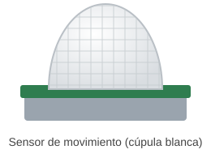
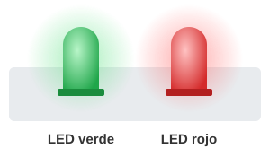
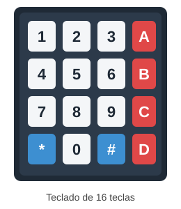
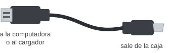

# Manual del Usuario

**Alarma con sensor de movimiento y clave de desactivación**  
Proyecto Integrador – Sistemas Digitales I  
EEST N°1 – 5°3

**Integrantes:** Alexis Maier, Aramis Demaria, Santino Laudati e Ian Quiroga  
**Profesor:** Lic. Prof. Nicolás Salimbeni  
**Versión:** 2.0  
**Fecha:** 16 de noviembre de 2026

## Sobre este proyecto

Esta alarma es el **Proyecto Integrador de Sistemas Digitales I** del curso 5°3 de la EEST N°1. El objetivo fue diseñar y construir una alarma que detecte movimiento, avise con luces y sonido, y que solo se pueda desactivar con una clave escrita en un teclado.

El resultado es un equipo compacto, dentro de una caja impresa en 3D, que se conecta por USB y no necesita internet. Este manual explica cómo usarlo, paso a paso y con palabras simples.

## Índice

1. ¿Qué es esta alarma?
2. Conozca su alarma
3. Antes de empezar
4. Encender y apagar
5. Cómo usar la alarma
6. La clave
7. Qué significa cada luz y cada sonido
8. Problemas comunes
9. Cuidados y seguridad
10. Datos de la alarma
11. Tarjeta de uso rápido
12. Glosario
13. Preguntas frecuentes

## 1. ¿Qué es esta alarma?

Es una alarma que **avisa con luz y sonido cuando alguien se mueve** frente a ella. Se activa y se desactiva con una **clave** que se escribe en su teclado, para que solo quien la conoce pueda manejarla.

Todo el equipo viene dentro de una caja. Desde afuera solo se ven el sensor, dos luces, el teclado, una palanca de encendido y el cable para conectarla.

**Para qué se puede usar:** vigilar la entrada de una habitación, un pasillo o un armario, o avisar cuando alguien pasa por un lugar.

---

## 2. Conozca su alarma

### 2.1. Sensor de movimiento

Es la **cúpula blanca** de la parte de arriba de la caja. Es el "ojo" de la alarma: percibe el calor del cuerpo de las personas cuando se mueven delante de él, hasta unos 7 metros de distancia.

- No necesita luz: funciona igual de día y de noche.
- No graba ni saca fotos: solo nota que algo se movió.
- Nada debe taparlo: ni objetos, ni cinta, ni vidrio delante.

### 2.2. Luces

- **Luz verde:** está **encendida cuando no hay nadie moviéndose** frente al sensor. Se **apaga** mientras el sensor ve movimiento. Le sirve para comprobar que el sensor funciona: pase la mano por delante y la luz verde se apaga por un momento.
- **Luz roja:** se enciende cuando **la alarma está sonando**, es decir, cuando la alarma estaba activada y alguien se movió.

### 2.3. Sonido

Dentro de la caja hay una pequeña sirena (zumbador). Suena **de forma continua**, junto con la luz roja, cuando la alarma detecta a alguien. No para sola: hay que apagarla con la clave.

### 2.4. Teclado

Con el teclado se escribe la clave y se le dan órdenes a la alarma.

| Tecla | Para qué sirve |
|---|---|
| `0` a `9` | Escribir la clave |
| `A` | **Activar** la alarma, o **apagar el sonido** cuando está sonando |
| `B` | **Desactivar** la alarma |
| `C` | **Cambiar la clave** |
| `*` | **Borrar** el último número escrito |
| `#` | **Confirmar** (como "Aceptar" o "Enter") |
| `D` | No se usa |

Si está escribiendo una clave y aprieta una letra (`A`, `B`, `C` o `D`), se cancela lo que estaba escribiendo y puede empezar de nuevo.

### 2.5. Palanca de encendido

Enciende y apaga toda la alarma.

### 2.6. Cable

Es el cable que sale de la caja. Le da energía a la alarma. Se conecta a un puerto **USB** de una **computadora**, a un **cargador de celular** o a una **batería externa** (power bank).

---

## 3. Antes de empezar

### 3.1. Dónde colocarla

- Ubique la alarma con el sensor **mirando hacia el lugar que quiere vigilar**, por ejemplo la puerta o el pasillo.
- Lo ideal es ponerla en un estante o mueble a una altura de **1,5 a 2 metros**.
- **Evite** que el sensor apunte al sol, a estufas, a aires acondicionados o a ventanas. Esas cosas cambian el calor del ambiente y pueden hacer sonar la alarma sin motivo.
- Si hay **mascotas**, tenga en cuenta que la alarma también las detecta.
- Déjela donde pueda llegar cómodo al teclado.

### 3.2. Qué necesita

- Una computadora, un cargador de celular o una batería externa con salida USB.
- Saber la clave. La de fábrica es **`1234`**.

---

## 4. Encender y apagar

### 4.1. Encender

1. Conecte el cable a la computadora, al cargador o a la batería.
2. Mueva la **palanca** a la posición de encendido.
3. **No apriete ninguna tecla mientras la enciende.**
4. Espere **1 minuto** sin moverse delante del sensor. En ese tiempo el sensor se acomoda, y es normal que la luz verde se apague o parpadee.
5. Al terminar, la luz verde queda encendida y la alarma está lista para usar. Todavía **no está activada**.

### 4.2. Apagar

Mueva la palanca a la posición de apagado. Si no la va a usar por un tiempo, desconecte también el cable.

> **Atención:** cada vez que la alarma se apaga o se desconecta, la clave vuelve a ser **`1234`** (ver sección 6.3).

---

## 5. Cómo usar la alarma

### 5.1. Activar la alarma

1. Apriete **`A`**.
2. Escriba la clave.
3. Apriete **`#`**.
4. Tiene **10 segundos** para alejarse del sensor. Después de ese tiempo la alarma queda activada y vigilando.

Si se equivoca de clave, la alarma no se activa. Vuelva a empezar desde el paso 1.

### 5.2. Cuando la alarma detecta a alguien

Si la alarma está activada y alguien se mueve frente al sensor:

- Se enciende la **luz roja**.
- Suena la **sirena** sin parar.
- Aunque la persona se quede quieta o se vaya, la alarma **sigue sonando** hasta que alguien escriba la clave.

### 5.3. Apagar el sonido y seguir vigilando

Sirve, por ejemplo, si fue usted quien hizo sonar la alarma sin querer y quiere que siga cuidando el lugar.

1. Apriete **`A`**.
2. Escriba la clave.
3. Apriete **`#`**.

La luz roja y el sonido se apagan, pero la alarma **sigue activada**. Va a volver a sonar si detecta un movimiento nuevo, después de que la luz verde se haya vuelto a encender.

### 5.4. Desactivar la alarma

1. Apriete **`B`**.
2. Escriba la clave.
3. Apriete **`#`**.

La luz roja y el sonido se apagan y la alarma deja de vigilar. Puede moverse frente a ella sin que suene. La luz verde sigue mostrando si hay movimiento, pero ya no hace sonar nada.

Se puede desactivar tanto mientras está sonando como cuando está vigilando en silencio.

### 5.5. Si se equivoca

- Si escribió un número de más, apriete **`*`** para borrarlo.
- Si quiere empezar de nuevo, apriete una letra para cancelar y repita los pasos.
- Si confirma una clave incorrecta, **la alarma no hace caso**: sigue sonando o sigue como estaba. Vuelva a intentarlo.
- Puede intentarlo todas las veces que necesite.

---

## 6. La clave

### 6.1. Clave de fábrica

La alarma viene con la clave **`1234`**.

### 6.2. Cambiar la clave

Se puede cambiar cuando la alarma **no está sonando**.

1. Apriete **`C`**.
2. Escriba la **clave actual** y apriete **`#`**.
3. Escriba la **clave nueva** y apriete **`#`**. Tiene que tener entre **4 y 8 números**.
4. Listo: desde ahora la alarma usa la clave nueva.

Si en el paso 2 escribe mal la clave actual, la clave no se cambia.

### 6.3. Importante: la clave nueva se borra al apagar

La alarma **no recuerda la clave nueva** cuando se queda sin energía. Si se **desconecta el cable** o se **apaga con la palanca**, al volver a encenderla la clave vuelve a ser **`1234`**.

Por eso:

- Después de cada encendido, la clave es `1234`.
- Si la cambió, vuelva a cambiarla cada vez que encienda la alarma.
- **Si se olvidó la clave**, apague la alarma y vuelva a encenderla: la clave vuelve a ser `1234`.

### 6.4. Consejos

- No use claves fáciles de adivinar, como `0000` o su fecha de nacimiento.
- Que nadie lo vea mientras escribe la clave.

---

## 7. Qué significa cada luz y cada sonido

| Luz verde | Luz roja | Sonido | Qué significa | Qué hacer |
|---|---|---|---|---|
| Apagada | Apagada | Silencio | La alarma está apagada | Encenderla con la palanca y revisar el cable |
| Encendida | Apagada | Silencio | No hay movimiento frente al sensor | Uso normal |
| Se apaga un momento | Apagada | Silencio | El sensor vio movimiento, pero la alarma no está activada | Nada; es normal |
| Apagada | **Encendida** | **Continuo** | La alarma detectó a alguien | Escribir la clave con `A` (apagar el sonido) o `B` (desactivar) |

> **Tenga en cuenta:** la alarma no tiene una luz que indique si está activada o desactivada mientras está en silencio. Recuerde qué fue lo último que hizo. Si tiene dudas, desactívela con `B` y vuelva a activarla con `A`.

---

## 8. Problemas comunes

| Problema | Qué hacer |
|---|---|
| No se enciende ninguna luz | Revise que la palanca esté en encendido y que el cable esté bien conectado. Pruebe con otro puerto USB u otro cargador |
| La alarma no arranca al encenderla | Apáguela, suelte todas las teclas y vuelva a encenderla sin tocar el teclado |
| La luz verde no se apaga cuando paso la mano | Espere 1 minuto después de encenderla. Revise que nada tape el sensor |
| La luz verde está siempre apagada | Algo se está moviendo o hay calor frente al sensor (sol, estufa, aire, una mascota). Apunte la alarma a otro lugar y espere 1 o 2 minutos |
| Suena sin que nadie pase | Aleje el sensor del sol, de estufas, de aires acondicionados y de ventanas |
| No suena cuando alguien pasa | Revise que la haya activado con `A`, clave y `#`, y que hayan pasado los 10 segundos |
| Escribo la clave y no pasa nada | Recuerde apretar `#` al final. Si cambió la clave y después la apagó, ahora la clave es `1234` |
| No me acuerdo la clave | Apague y vuelva a encender la alarma: la clave vuelve a ser `1234` |
| Alguna tecla no responde | Apriétela con firmeza en el centro. Si sigue sin responder, consulte al responsable del equipo |
| Apagué el sonido y no vuelve a sonar | Espere a que la luz verde se encienda. Recién ahí un movimiento nuevo la hace sonar otra vez |

> Si el problema sigue, **no abra la caja**. Apague la alarma, desconecte el cable y consulte al responsable del equipo.

---

## 9. Cuidados y seguridad

### 9.1. Cuidados

- Limpie la cúpula del sensor y el teclado con un paño **seco** y suave.
- No moje la alarma ni use alcohol o productos de limpieza sobre ella.
- No la deje al sol ni cerca de fuentes de calor: la caja es de plástico y puede deformarse.
- No tire del cable para desconectarlo: sujete el conector.
- Guárdela en un lugar seco y sin polvo.
- No golpee la cúpula del sensor.

### 9.2. Seguridad

- Funciona con la baja tensión de un USB y no tiene riesgo de descarga eléctrica. Igualmente, **no abra la caja** ni meta objetos por sus aberturas.
- Si nota olor a quemado o que la caja se calienta, desconecte el cable de inmediato.
- No la use cerca del agua.
- No la deje al alcance de niños pequeños sin supervisión.
- Es un proyecto escolar: **no la use como única protección** de personas, de su casa o de objetos de valor.

### 9.3. Privacidad

- La alarma no graba imágenes ni sonido, y no se conecta a internet.
- Si la instala donde hay otras personas, avíseles que hay un sensor de movimiento.

---

## 10. Datos de la alarma

| Dato | Valor |
|---|---|
| Medidas de la caja | 17 × 14 × 9 cm |
| Alimentación | Cable USB (computadora, cargador de celular o batería externa) |
| Distancia de detección | Hasta unos 7 metros |
| Tiempo de espera al encender | 1 minuto |
| Tiempo para alejarse al activarla | 10 segundos |
| Clave de fábrica | `1234` |
| Largo de la clave | De 4 a 8 números |
| Avisos | Luz verde, luz roja y sirena |
| Uso | Interior, lugar seco |

---

## 11. Tarjeta de uso rápido

| Quiero... | Hago... |
|---|---|
| Encender | Cable conectado → palanca en encendido → esperar 1 minuto |
| Activar la alarma | `A` → clave → `#` → alejarme durante 10 segundos |
| Apagar el sonido y seguir vigilando | `A` → clave → `#` |
| Desactivar la alarma | `B` → clave → `#` |
| Cambiar la clave | `C` → clave actual → `#` → clave nueva → `#` |
| Borrar un número | `*` |
| Cancelar lo que escribí | Apretar una letra |
| Apagar | Palanca en apagado |

**Clave de fábrica: `1234`. Vuelve a ser `1234` cada vez que se apaga la alarma.**

---

## 12. Glosario

| Palabra | Qué quiere decir |
|---|---|
| **Activar** | Poner la alarma a vigilar. A partir de ese momento, si alguien se mueve, suena. |
| **Desactivar** | Hacer que la alarma deje de vigilar. Aunque alguien se mueva, no suena. |
| **Clave** | Número secreto de 4 a 8 cifras que se escribe en el teclado para manejar la alarma. |
| **Clave de fábrica** | La clave con la que viene la alarma: `1234`. |
| **Sensor de movimiento** | La cúpula blanca de arriba. Nota el calor de las personas cuando se mueven. |
| **LED** | Pequeña luz. La alarma tiene una verde y una roja. |
| **Zumbador** | La pequeña sirena que hay dentro de la caja y que hace sonar la alarma. |
| **USB** | El tipo de enchufe del cable. Es el mismo que usan los celulares y las computadoras. |
| **Batería externa (power bank)** | Batería portátil para cargar celulares. Sirve para usar la alarma lejos de un enchufe. |
| **Palanca** | El interruptor de la caja que enciende y apaga la alarma. |

---

## 13. Preguntas frecuentes

**¿Por qué tengo que esperar 1 minuto al encenderla?**  
El sensor necesita ese tiempo para acomodarse. Si se activa antes, puede sonar sin motivo.

**¿Por qué la luz verde se apaga aunque la alarma esté desactivada?**  
La luz verde solo muestra si el sensor ve movimiento. Que se apague no significa que la alarma vaya a sonar.

**¿Cómo sé si la alarma está activada?**  
No hay una luz para eso. Recuerde lo último que hizo. Si tiene dudas, desactívela con `B` y vuelva a activarla con `A`.

**¿Por qué volvió la clave `1234`?**  
Porque la alarma se apagó o se desconectó. La clave nueva solo dura mientras la alarma está encendida.

**¿Qué hago si me olvidé la clave?**  
Apague la alarma y vuelva a encenderla: la clave vuelve a ser `1234`.

**¿Necesita WiFi o internet?**  
No. Funciona sola.

**¿Detecta a través de un vidrio?**  
No. El sensor tiene que ver directamente la zona a vigilar.

**¿Detecta mascotas?**  
Sí. El sensor detecta el calor de cualquier cuerpo que se mueva.

**¿Funciona de noche, a oscuras?**  
Sí. El sensor no necesita luz.

**¿Para qué sirve la tecla `D`?**  
No tiene uso.

**¿Puedo dejarla conectada a la computadora todo el día?**  
Sí. Si no la va a usar, apáguela con la palanca.

---

**Fin del Manual del Usuario.**
